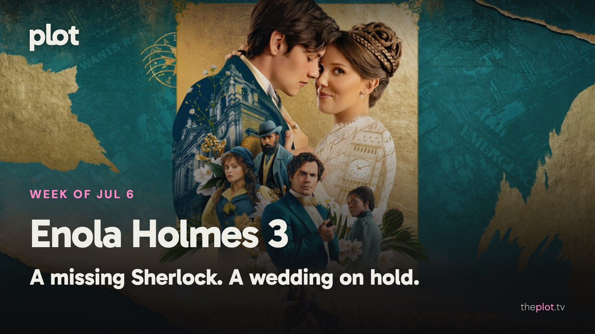

Enola Holmes has picked an inconvenient week to get married. Sherlock is missing, the Minions are making movies, and the kitchen at *The Bear* is preparing its last service. Ahead, *Moana* returns in live action and a new *Little House on the Prairie* opens its doors. Your weekend choices are less restful: a childhood secret or a mother with everything to lose.

Image: Enola Holmes 3 (2026), promotional backdrop. Source: [TMDB](https://www.themoviedb.org/movie/1202033). Text overlay by Plot.

[See Minions & Monsters on Plot](https://theplot.tv/movie/minions-monsters-1315772).

## In theaters

Image: Minions & Monsters (2026), promotional backdrop. Source: [TMDB](https://www.themoviedb.org/movie/1315772).

*Minions & Monsters* heads to old Hollywood to make a monster movie. Their [estimated $61 million five-day domestic opening over July 1-5 was the franchise's smallest](https://www.thewrap.com/creative-content/movies/minions-and-monsters-weekend-box-office/). Winning the holiday weekend still came with a warning sign.

*Supergirl* gives Milly Alcock a bruised, grief-stricken hero rather than another spotless savior. [Rolling Stone Philippines finds her performance stronger than the film around her](https://rollingstonephilippines.com/culture/reviews/supergirl-2026-movie-review-milly-alcock/). Go for a messier cousin of Superman.

*Toy Story 5*. Bonnie has a tablet now, and the toys have competition. [Slant finds Pixar's new film more instructive than imaginative](https://www.slantmagazine.com/film/toy-story-5-review-pixar-tom-hanks-tim-allen/). Parents may recognize the problem before anyone finishes explaining it.

## What everyone's talking about

*Enola Holmes 3* is testing how grown-up this mystery franchise should become. [Tom's Guide welcomes a more emotional, higher-stakes film](https://www.tomsguide.com/entertainment/netflix/enola-holmes-3-review-millie-bobby-brown-shines-in-the-mystery-franchises-best-most-intense-chapter-yet), with Millie Bobby Brown keeping its humor intact. The [period-drama audience discussion](https://www.reddit.com/r/PeriodDramas/comments/1ul1ze5/enola_holmes_3_thoughts_no_spoilers/) gets snagged on something more immediate: whether the styling lets you believe in its world. The disagreement is useful if you loved the earlier films. Some viewers want the heroine to mature; others first need the illusion to hold. A recognizable face and a prettier location won't settle both questions. [Find Enola Holmes 3 on Plot](https://theplot.tv/movie/enola-holmes-3-1202033).

Image: The Bear (2022), promotional backdrop. Source: [TMDB](https://www.themoviedb.org/tv/136315).

*The Bear* has rediscovered the value of a deadline. Its fifth and final season concentrates on a restaurant day rather than finding another reason to postpone one. [TheWrap credits the tighter storytelling while questioning whether it repairs the preceding seasons](https://www.thewrap.com/creative-content/tv-shows/the-bear-season-5-review-fx/). The [first-review roundup finds broad enthusiasm for this return to focus](https://editorial.rottentomatoes.com/article/the-bear-season-5-first-reviews/). For anyone who drifted away from the Hulu series, that is the useful news: the ending asks the ensemble to work together again. No spoilers, and no reservation required.

GIF: A carefully planned celebration immediately going off course. Savannah to choose the GIF.

## Now on TV and Streaming

Image: Enola Holmes 3 (2026), promotional backdrop. Source: [TMDB](https://image.tmdb.org/t/p/original/jLuGZc84MvPYCQomQg9DI72mstt.jpg).

*Enola Holmes 3* is [now on Netflix](https://media.netflix.com/en/only-on-netflix/81605886). The film takes its detective to Malta, where a missing brother interrupts her wedding plans. A family reunion with considerably more running than anyone put on the invitation.

Image: Little Brother (2026), promotional backdrop. Source: [TMDB](https://www.themoviedb.org/movie/1397385).

John Cena's carefully managed life meets Eric André's enthusiasm for wrecking it. [Netflix's new comedy film *Little Brother*](https://www.netflix.com/tudum/articles/little-brother-john-cena-eric-andre) makes an unexpected family reunion the problem. For a night when subtlety can take the evening off.

## Coming up

TRAILER: https://www.youtube.com/watch?v=n7f6hlKsxxo

*Moana* opens Friday, July 10. Catherine Laga'aia takes the lead in Disney's live-action film, with Dwayne Johnson returning as Maui. Familiar songs and an ocean voyage for the household that has already worn out the animated version.

TRAILER: https://www.youtube.com/watch?v=nMzhf6qYJ4I

*Evil Dead Burn* opens Friday, July 10. The new horror film puts another group within reach of the franchise's malicious dead. Sébastien Vaniček, who made *Infested*, directs. For viewers who regard a quiet cabin weekend as wasted potential.

TRAILER: https://www.youtube.com/watch?v=jSds4Oi83Eg

*Little House on the Prairie* reaches Netflix Thursday, July 9. The new series follows the Ingalls family on the frontier. Family life and the practical business of surviving give it an invitation beyond nostalgia for the earlier show.

## The charts

Historical trending chart for July 6, 2026: no weekly snapshot is available in the saved archive. This draft needs its historical chart before publication.

[Explore more titles on Plot](https://theplot.tv/whats-on/chart).

## Weekend watch

Image: I'm Not Afraid (2026), promotional backdrop. Source: [TMDB](https://www.themoviedb.org/tv/290232).

*I'm Not Afraid* arrives on Netflix Wednesday, July 8. [The Mexican series follows a boy who discovers a frightening secret](https://www.netflix.com/tudum/articles/what-to-watch-on-netflix-july-3-2026). Choose this when the uneasy feeling that adults aren't telling you everything sounds like a good way to spend an evening. [Save I'm Not Afraid for the weekend](https://app.theplot.tv/save?media_type=tv&tmdb_id=290232&src=newsletter).

Image: Nothing to Lose (2026), promotional backdrop. Source: [TMDB](https://www.themoviedb.org/movie/1710008).

*Nothing to Lose* is a new [French drama film on Netflix](https://www.netflix.com/title/81988477), arriving Wednesday, July 8. A mother searches for a donor who could save her son. A direct emotional setup for a night when the mystery can wait and the people matter most. [Save Nothing to Lose for the weekend](https://app.theplot.tv/save?media_type=movie&tmdb_id=1710008&src=newsletter).

Save your picks to your Plot watchlist while the week is still young. Friday-you has earned a seat on the couch, not another research assignment.

Be that friend. Give the group chat its weekend watchlist.

Chart and title artwork: TMDB. This newsletter uses the TMDB API but is not endorsed or certified by TMDB.
