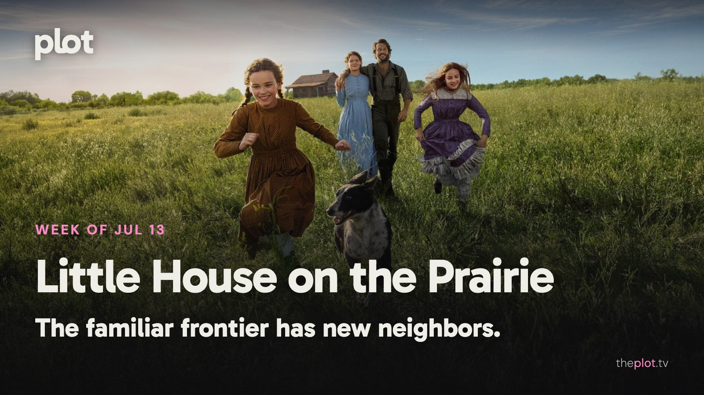

The Ingalls family is starting over, and so is *Moana*. One return is inviting viewers to reassess a childhood favorite; the other is discovering that familiar songs don't guarantee a packed theater. This week also brings Anya Taylor-Joy on the run, Will Ferrell refusing to retire, and Christopher Nolan sending Matt Damon on a much longer trip home.

Image: Little House on the Prairie (2026), promotional backdrop. Source: [TMDB](https://www.themoviedb.org/tv/283304). Text overlay by Plot.

[See Moana on Plot](https://theplot.tv/movie/moana-1108427).

## In theaters

Image: Moana (2026), promotional backdrop. Source: [TMDB](https://www.themoviedb.org/movie/1108427).

*Moana*'s live-action return [opened to an estimated $43 million domestically over July 10-12, below Disney's roughly $60 million expectation](https://www.thewrap.com/creative-content/movies/why-moana-remake-flopped-analysis-box-office/). For a major remake, that is a disappointing start rather than an automatic victory lap.

*Evil Dead Burn* is the week's much less family-friendly reunion. [Its review discussion shows critics differing on whether the brutality is inventive or exhausting](https://www.reddit.com/r/movies/comments/1uqwvv4/evil_dead_burn_review_thread/). The appetite for gore matters more here than affection for a familiar title.

*Minions & Monsters* turns the little yellow agents of chaos into aspiring filmmakers. [AP finds the Hollywood in-jokes more tiring than inspired](https://apnews.com/article/20f06af5081712ead0ff6658c4206ab4). The adults recognizing the references may not be the same people laughing at them.

## What everyone's talking about

*Little House on the Prairie* is exposing two different kinds of nostalgia. Some viewers want the comfort of the old television show; others want the particular childhood perspective of the books. In a [substantial fan discussion](https://www.reddit.com/r/littlehouseonprairie/comments/1uu97v4/did_anyone_else_find_the_netflix_reboot_kinda/), the new Netflix series draws criticism for feeling polished and contemporary, alongside defenses of its broader community. [The Los Angeles Times sees fidelity to the novel's spirit despite changes](https://www.latimes.com/entertainment-arts/tv/story/2026-07-09/little-house-on-prairie-review-netflix-laura-ingalls-wilder). A remake can keep the people and still change what it feels like to live beside them. [Find Little House on the Prairie on Plot](https://theplot.tv/tv/little-house-on-the-prairie-283304).

*Moana* has a remake problem that affection alone can't solve. Its songs and heroine remain easy to love, but those are also reasons to watch the animated original. [TheWrap's review argues that the live-action film adds too little to justify the return](https://www.thewrap.com/creative-content/movies/moana-review-disney-live-action-remake/). That criticism leaves room for Catherine Laga'aia's promise as a performer. The question is what this version lets her make her own. Familiarity can be a family outing's selling point; it is a harder answer to why a film needed making again.

## Now on TV and Streaming

Image: Little House on the Prairie (2026), promotional backdrop. Source: [TMDB](https://image.tmdb.org/t/p/original/fBieUo3SdItUrXZE16YxbpjwXIe.jpg).

[Netflix's new *Little House on the Prairie* series](https://media.netflix.com/en/only-on-netflix/81748089) follows the Ingalls family building a home on the frontier. Work, weather, and growing children supply the stakes. Try it when you want family drama without a murder board.

Image: Shipwrecked: Nightmare at Sea (2026), promotional backdrop. Source: [TMDB](https://www.themoviedb.org/movie/1715492).

*Shipwrecked: Nightmare at Sea* is [Netflix's documentary film about the 2012 cruise disaster](https://www.netflix.com/tudum/articles/what-to-watch-on-netflix-july-10-2026). Survivor testimony and footage put you inside a holiday becoming an emergency. Save the cruise browsing for a different evening.

## Coming up

https://www.youtube.com/watch?v=Mzw2ttJD2qQ

*The Odyssey* opens Friday, July 17. Christopher Nolan's film follows Odysseus trying to return from war, with Matt Damon leading the voyage. Monsters are the obvious attraction; a man trying to find his way back to his family gives the spectacle its pull.

https://www.youtube.com/watch?v=locuQ-skySE

*Heartstopper Forever* reaches Netflix Friday, July 17. The film closes Nick and Charlie's story as life after school approaches. For the fans who have watched these boys learn how to speak to each other and would like a proper goodbye.

https://www.youtube.com/watch?v=sSRJ6PXHx88

*The Hawk* lands on Netflix Thursday, July 16. Will Ferrell plays an aging golf champion in the new comedy series. His comeback threatens to become everyone else's problem. Pick this for wounded pride in very confident leisurewear.

## The charts

Historical trending chart for July 13, 2026: no weekly snapshot is available in the saved archive. This draft needs its historical chart before publication.

[Explore more titles on Plot](https://theplot.tv/whats-on/chart).

## Weekend watch

Image: Lucky (2026), promotional backdrop. Source: [TMDB](https://www.themoviedb.org/tv/278624).

*Lucky* begins on Apple TV Wednesday, July 15. [Anya Taylor-Joy plays a criminal trying to leave that life behind](https://www.apple.com/tv-pr/news/2026/02/apple-tv-unveils-the-premiere-date-first-look-and-teaser-for-lucky-new-limited-series-starring-and-executive-produced-by-sag-and-golden-globe-award-winner-anya-taylor-joy-premiering-globally-wednesday-july-15-2026/). The limited series offers a chase and a woman whose most useful skills may keep pulling her backward. [Save Lucky for the weekend](https://app.theplot.tv/save?media_type=tv&tmdb_id=278624&src=newsletter).

Image: The East Palace (2026), promotional backdrop. Source: [TMDB](https://www.themoviedb.org/tv/279323).

*The East Palace* arrives on Netflix Friday, July 17. [The Korean fantasy series pairs a man who enters the spirit world with a woman who hears the dead](https://www.netflix.com/tudum/articles/what-to-watch-on-netflix-july-17-2026). A palace mystery where the building's history may be considerably more talkative than expected. [Save The East Palace for the weekend](https://app.theplot.tv/save?media_type=tv&tmdb_id=279323&src=newsletter).

Put a little order in the weekend before the weekend puts a remote in your hand. Save these to your Plot watchlist; arguing about dinner is quite enough.

Be that friend. Give the group chat its weekend watchlist.

Chart and title artwork: TMDB. This newsletter uses the TMDB API but is not endorsed or certified by TMDB.
