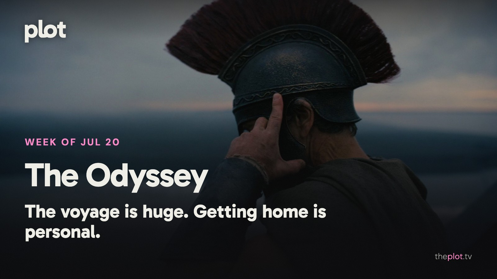

*The Odyssey* has arrived with enough sea, steel, and sound to make a multiplex feel small. At home, *Heartstopper* is saying goodbye and *Lucky* has barely stopped running. Coming Friday: Alan Ritchson wants revenge, Aang is growing up, and a failed tennis pro discovers the enemy has a smaller racket.

Image: The Odyssey (2026), promotional backdrop. Source: [TMDB](https://www.themoviedb.org/movie/1368337). Text overlay by Plot.

[See The Odyssey on Plot](https://theplot.tv/movie/moana-1108427).

## In theaters

Image: The Odyssey (2026), promotional backdrop. Source: [TMDB](https://image.tmdb.org/t/p/original/nVBzWBqHTB3XD0iqWiJLfKLo5fq.jpg).

*The Odyssey* puts Matt Damon between a devastating war and a home he cannot reach. [TheWrap finds a sensitive homecoming story inside the horror and spectacle](https://www.thewrap.com/creative-content/reviews/the-odyssey-review-christopher-nolan/). A strong reason to leave your own home for a very large screen.

The live-action *Moana* keeps the voyage and the songs recognizable. [Disney's film brings Catherine Laga'aia together with Dwayne Johnson's Maui](https://movies.disney.com/moana-2026). The easy choice for an audience that wants to sing along before it wants to be surprised.

[The latest *Evil Dead Burn* film](https://www.warnerbros.com/movies/evil-dead-burn) offers the opposite sort of group activity: watch people make contact with a force they should have left alone. Sébastien Vaniček directs this round. A comfort franchise with an unusually hostile definition of comfort.

## What everyone's talking about

*The Odyssey* is drawing viewers toward the human cost beneath its monsters. In the [Nolan audience discussion](https://www.reddit.com/r/ChristopherNolan/comments/1uxanln/the_odyssey_discussion_thread_spoilers/), viewers return to guilt, homecoming, and the parallels with *Oppenheimer*, alongside the overwhelming sound and spectacle. You don't need to know the poem to recognize that tension. A great victory can leave someone very poorly equipped for ordinary life. The most interesting conversation is about what Odysseus carries home, rather than whether the film has enough creatures to justify the ticket. [Find The Odyssey on Plot](https://theplot.tv/movie/the-odyssey-1368337).

Image: Lucky (2026), promotional backdrop. Source: [TMDB](https://www.themoviedb.org/tv/278624).

*Lucky* turns the chase thriller into a question about inheritance. Can a con artist start again when the thing she is best at is the thing she wants to escape? [TVLine finds Anya Taylor-Joy's performance and the opening action propulsive](https://www.tvline.com/2215166/lucky-review-apple-tv-anya-taylor-joy/). [Showrunner Cassie Pappas describes putting women on each side of the pursuit](https://www.marieclaire.com/culture/tv-shows/lucky-showrunner-cassie-pappas-interview/). That is the creative intention, rather than a verdict on the whole series. The hook is good enough without one: being very capable can make changing your life harder.

GIF: An overconfident athlete realizing the competition has changed. Savannah to choose the GIF.

## Now on TV and Streaming

Image: Heartstopper Forever (2026), promotional backdrop. Source: [TMDB](https://www.themoviedb.org/movie/1468683).

[Netflix's film *Heartstopper Forever*](https://media.netflix.com/en/only-on-netflix/82040750) brings the teen romance series to a close. Nick and Charlie face the distance and decisions that follow school. A familiar group reaching the age when loving each other and planning a future stop being the same task.

Image: The Hawk (2026), promotional backdrop. Source: [TMDB](https://www.themoviedb.org/tv/254528).

*The Hawk* is [Will Ferrell's new Netflix comedy series](https://media.netflix.com/en/only-on-netflix/81695311) about a golf champion chasing one more major. His body and family are less convinced than he is. For anyone who enjoys a grand self-image meeting some inconvenient evidence.

## Coming up

TRAILER: https://www.youtube.com/watch?v=t6RklhKu9os

*Motor City* opens Friday, July 24. Alan Ritchson plays a man framed and sent to prison in 1970s Detroit. The revenge thriller leans on physical action and music. Choose it when the plan is fewer speeches, more consequences.

TRAILER: https://www.youtube.com/watch?v=7b20GRFZBFE

*Avatar Aang: The Last Airbender* arrives on Paramount+ Friday, July 24. The animated film returns to Aang as an adult. A reunion for viewers whose attachment to this world goes back further than the latest live-action adaptation.

TRAILER: https://www.youtube.com/watch?v=YyVNFzx5Pl8

*The Dink* reaches Apple TV Friday, July 24. Jake Johnson plays a washed-up tennis pro discovering pickleball. Mary Steenburgen and Ed Harris join him. The sports comedy is for people who know that an argument about a game is rarely only about the game.

## The charts

Historical trending chart for July 20, 2026: no weekly snapshot is available in the saved archive. This draft needs its historical chart before publication.

[Explore more titles on Plot](https://theplot.tv/whats-on/chart).

## Weekend watch

Image: 72 Hours (2026), promotional backdrop. Source: [TMDB](https://www.themoviedb.org/movie/949838).

*72 Hours* arrives on Netflix Friday, July 24. [Kevin Hart's new comedy film sends an advertising executive to a younger crowd's bachelor party](https://media.netflix.com/en/only-on-netflix/81715790). An accidental group-chat invitation becomes an extremely poor career strategy. Enjoy the secondhand embarrassment from somewhere with a sensible bedtime. [Save 72 Hours for the weekend](https://app.theplot.tv/save?media_type=movie&tmdb_id=949838&src=newsletter).

Image: Ransom Canyon (2025), promotional backdrop. Source: [TMDB](https://www.themoviedb.org/tv/240993).

*Ransom Canyon* returns to Netflix Thursday, July 23. [Season two brings more romance and risky ventures in ranchland Texas](https://www.netflix.com/tudum/articles/what-to-watch-on-netflix-july-17-2026). For the evening when you want a sprawling series where business decisions and romantic decisions can both go spectacularly wrong. [Save Ransom Canyon for the weekend](https://app.theplot.tv/save?media_type=tv&tmdb_id=240993&src=newsletter).

Save these to your Plot watchlist now. By Friday, your only ambitious undertaking should be carrying the snacks and the drinks in one trip.

Be that friend. Give the group chat its weekend watchlist.

Chart and title artwork: TMDB. This newsletter uses the TMDB API but is not endorsed or certified by TMDB.
