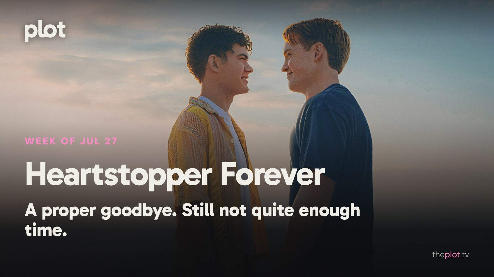

Saying goodbye to *Heartstopper* has reminded everyone how much a supporting character can mean to you. *The Dink* finds a different sort of wounded pride on the pickleball court, while *Motor City* keeps the arguments mostly physical. This week, Spider-Man and Batman return in very different moods, and Mario finally heads for the living-room screen.

Image: Heartstopper Forever (2026), promotional backdrop. Source: [TMDB](https://www.themoviedb.org/movie/1468683). Text overlay by Plot.

## In theaters

Image: Motor City (2026), promotional backdrop. Source: [TMDB](https://www.themoviedb.org/movie/87513).

[Alan Ritchson's *Motor City*](https://www.independentfilmco.com/films/motor-city) turns a wrongful conviction into a revenge mission in 1970s Detroit. The film's emphasis on bodies, music, and momentum makes it a change of pace from a summer of dialogue explaining entire universes.

*The Odyssey* is [Christopher Nolan's journey home from the Trojan War](https://www.universalpictures.com/movies/the-odyssey). The attractions are on a scale your television cannot reproduce. If a summer evening deserves a film that takes over the whole evening, this is the obvious candidate.

[The live-action *Moana*](https://movies.disney.com/moana-2026) is still offering an ocean voyage with familiar songs. Catherine Laga'aia leads, with Dwayne Johnson as Maui. A straightforward family choice when agreement matters more than discovering something unfamiliar.

## What everyone's talking about

*Heartstopper Forever* has given fans an ending and a new reason to wish for more time. The film still values emotional openness, and [Autostraddle celebrates that while missing the space the series gave its wider friendship group](https://www.autostraddle.com/heartstopper-forever-provides-a-very-sweet-very-queer-ending-but-i-wish-there-could-be-more/). A [fan review and its replies](https://www.reddit.com/r/HeartstopperAO/comments/1uzgqvx/my_review_of_heartstopper_forever/) show affection surviving complaints about the compressed format. That is a more interesting response than simple disappointment. A goodbye can work for the central couple and still feel too hurried for the people you came to love beside them.

Image: The Dink (2026), promotional backdrop. Source: [TMDB](https://www.themoviedb.org/movie/1361774).

*The Dink* makes pickleball a threat to a man's identity, which is a perfectly reasonable foundation for a ridiculous sports comedy. [The Saturday Evening Post finds its sharpest joke in tennis players' contempt for the newcomers](https://www.saturdayeveningpost.com/2026/07/review-the-dink-movies-for-the-rest-of-us-with-bill-newcott/); [TheWrap finds that the premise wears thin](https://www.thewrap.com/creative-content/movies/the-dink-review-apple-tv-jake-johnson-ed-harris/). Your patience for watching someone get over himself may decide how long the joke lasts. Knowing the rules of pickleball is much less essential. The sore point is status, and that travels well beyond a court.

GIF: Taking a supposedly casual game much too seriously. Savannah to choose the GIF.

## Now on TV and Streaming

Image: 72 Hours (2026), promotional backdrop. Source: [TMDB](https://www.themoviedb.org/movie/949838).

[The Netflix comedy film *72 Hours*](https://media.netflix.com/en/only-on-netflix/81715790) puts Kevin Hart's middle-aged executive in the wrong bachelor-party chat. He goes along to rescue his career. For the part of you that would like to watch someone else send the ill-advised message.

Image: Avatar Aang: The Last Airbender (2026), promotional backdrop. Source: [TMDB](https://www.themoviedb.org/movie/980431).

*Avatar Aang: The Last Airbender* is [now on Paramount+](https://www.youtube.com/watch?v=7b20GRFZBFE). This animated film revisits Aang and his friends as adults. A way back into the world for longtime fans, with the pleasure of seeing familiar people at a different point in their lives.

## Coming up

TRAILER: https://www.youtube.com/watch?v=8TZMtslA3UY

*Spider-Man: Brand New Day* opens Friday, July 31. Tom Holland's Peter Parker is alone in a New York that has forgotten him. The new film has a more personal starting point than saving a multiverse: how do you keep helping people when nobody knows you?

TRAILER: https://www.youtube.com/watch?v=kjkTmTmC1iA

*I Want Your Sex* opens Friday, July 31. Gregg Araki's film pairs Olivia Wilde's provocative artist with Cooper Hoffman's young employee. For adults who want a summer movie with desire, awkward power dynamics, and something to discuss afterward.

TRAILER: https://www.youtube.com/watch?v=pNhijtUqyeg

*Batman: Caped Crusader* returns to Prime Video Friday, July 31. Season two of the animated series brings more detective work to its shadowy Gotham. The counterprogramming for anyone whose superhero mood is closer to a noir mystery than a citywide explosion.

## The charts

Your trending top ten for July 27, 2026.

1. [*The Odyssey*](https://theplot.tv/movie/the-odyssey-1368337), film.
2. [*Backrooms*](https://theplot.tv/movie/backrooms-1083381), film.
3. [*Obsession*](https://theplot.tv/movie/obsession-1339713), film.
4. [*Lucky*](https://theplot.tv/tv/lucky-278624), TV.
5. [*Silo*](https://theplot.tv/tv/silo-125988), TV.
6. [*Moana*](https://theplot.tv/movie/moana-1108427), film.
7. [*The Furious*](https://theplot.tv/movie/the-furious-1280738), film.
8. [*Spider-Man: Brand New Day*](https://theplot.tv/movie/spider-man-brand-new-day-969681), film.
9. [*The East Palace*](https://theplot.tv/tv/the-east-palace-279323), TV.
10. [*Descendants: Wicked Wonderland*](https://theplot.tv/movie/descendants-wicked-wonderland-1318621), film.

Want more? [See the full top 20 chart on Plot](https://theplot.tv/whats-on/chart).

Chart snapshot: 2026-07-23. Movement omitted because the preceding saved snapshot is not from the prior week.

## Weekend watch

Image: The Super Mario Galaxy Movie (2026), promotional backdrop. Source: [TMDB](https://www.themoviedb.org/movie/1226863).

*The Super Mario Galaxy Movie* lands on Peacock Thursday, July 30. [The streaming announcement promises the film and behind-the-scenes extras](https://www.peacocktv.com/blog/the-super-mario-galaxy-movie-streaming-date-revealed). Mario's animated space adventure is the easy family pick when everyone wants something colorful and nobody wants to negotiate a new set of characters. [Save The Super Mario Galaxy Movie for the weekend](https://app.theplot.tv/save?media_type=movie&tmdb_id=1226863&src=newsletter).

Image: Nightborn (2026), promotional backdrop. Source: [TMDB](https://www.themoviedb.org/movie/964849).

*Nightborn* arrives on Shudder Friday, July 31. [The horror film follows a couple whose newborn seems frighteningly unusual](https://www.youtube.com/watch?v=dWePsu_Kd9c). From *Hatching* director Hanna Bergholm, it turns the pressure of new parenthood into something monstrous. For after the small children are safely asleep. [Save Nightborn for the weekend](https://app.theplot.tv/save?media_type=movie&tmdb_id=964849&src=newsletter).

Give Friday a couple of good options. Save these to your Plot watchlist and let the remote enjoy a rare evening without a lengthy selection process.

Be that friend. Give the group chat its weekend watchlist.

Chart and title artwork: TMDB. This newsletter uses the TMDB API but is not endorsed or certified by TMDB.
