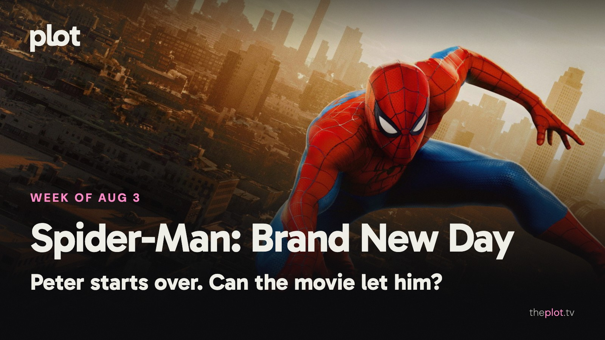

Spider-Man is back with fewer people to turn to and a more recognizable problem: being lonely in a very busy city. Batman is working a darker corner of the streaming menu. Ahead, *One Night Only* gives dating a deadline, *The Last House* makes staying in sound alarming, and *One Hundred Years of Solitude* returns to a family that has never had a simple week.

Image: Spider-Man: Brand New Day (2026), promotional backdrop. Source: [TMDB](https://www.themoviedb.org/movie/969681). Text overlay by Plot.

## In theaters

Image: Spider-Man: Brand New Day (2026), promotional backdrop. Source: [TMDB](https://image.tmdb.org/t/p/original/4tjxYg2AbOzzG9G1YuiT2NzYhlH.jpg).

*Spider-Man: Brand New Day* had an extraordinary start: [an estimated $927 million worldwide debut, the second-biggest ever](https://www.thewrap.com/creative-content/movies/spider-man-brand-new-day-box-office-opening-weekend/), including advance screenings. Tom Holland's lonely Peter Parker has plenty of company at the box office.

*The Odyssey* remains [Nolan's large-screen voyage through war, monsters, and homecoming](https://www.universalpictures.com/movies/the-odyssey). Matt Damon leads a very long trip back to Ithaca. If you have been saving it for a clear evening, give it the clear evening.

[Gregg Araki's *I Want Your Sex*](https://www.magpictures.com/iwantyoursex) puts a young employee inside a provocative artist's orbit. Olivia Wilde and Cooper Hoffman lead. An adult alternative to the franchise queue, with the art world's power games supplying the discomfort.

## What everyone's talking about

*Spider-Man: Brand New Day* is most interesting when Peter gets to be an ordinary person with extraordinary problems. [Slant praises the small-scale intimacy and clearer action, then questions the pull of the wider Marvel machinery](https://www.slantmagazine.com/film/spider-man-brand-new-day-review-tom-holland-zendaya/). [TechRadar also finds the promised fresh start compromised by familiar franchise habits](https://www.techradar.com/streaming/entertainment/spider-man-brand-new-day-review). These are concerns about focus, rather than objections to Holland. A lonely rooftop can tell you something about Peter; an expanding guest list can make him harder to find in his own movie. The neighborhood is the part worth protecting.

Image: Batman: Caped Crusader (2024), promotional backdrop. Source: [TMDB](https://www.themoviedb.org/tv/125909).

*Batman: Caped Crusader* makes a case for another Batman by giving the animated series a particular atmosphere. [Bloody Disgusting welcomes its darker exploration of Gotham and its hero](https://bloody-disgusting.com/reviews/3961303/batman-caped-crusader-second-season-review/). The [season discussion](https://www.reddit.com/r/DCcomics/comments/1vb9a1y/batman_caped_crusader_season_2_megathread/) turns to how the familiar rogues and detective stories work in this version. You can be tired of Batman announcements and still enjoy a Batman story with an identity. The appeal here is a city full of shadows, questionable motives, and cases that need solving.

## Now on TV and Streaming

[Season two of *Batman: Caped Crusader* is on Prime Video](https://www.aboutamazon.com/news/entertainment/batman-caped-crusader-release-date-trailer-prime-video). The animated series puts a noir mood around the detective work. A useful choice for anyone who enjoys Batman most when he has to work something out.

Image: The Super Mario Galaxy Movie (2026), promotional backdrop. Source: [TMDB](https://www.themoviedb.org/movie/1226863).

[Peacock now has *The Super Mario Galaxy Movie*](https://www.peacocktv.com/blog/the-super-mario-galaxy-movie-streaming-date-revealed). The animated sequel takes the familiar Nintendo crowd into space. For a family movie night with easy recognition and no homework beyond finding the good spot on the couch.

## Coming up

https://www.youtube.com/watch?v=JRG244IfrRE

*One Night Only* opens Friday, August 7. Will Gluck's romantic comedy imagines a world where premarital sex is permitted one night a year. Monica Barbaro and Callum Turner are trying to make a connection under the deadline. For the friend who says dating already feels overregulated.

https://www.youtube.com/watch?v=MLxgaz2Zp1k

*The Last House* reaches Netflix Friday, August 7. Greta Lee and Wagner Moura play parents whose family is sealed inside its home. The sci-fi thriller makes a familiar space the whole problem. An unusually tense argument for checking the doors.

https://www.youtube.com/watch?v=dimCiC_hdoA

*Teenage Sex and Death at Camp Miasma* opens Friday, August 7. Jane Schoenbrun's film follows a filmmaker drawn toward a slasher franchise's former star. Horror, desire, and the strange intimacy of loving an image are a potent invitation for the adventurous moviegoer.

## The charts

Your trending top ten for August 3, 2026.

1. [*The Odyssey*](https://theplot.tv/movie/the-odyssey-1368337), film. No change this week
2. [*Disclosure Day*](https://theplot.tv/movie/disclosure-day-1275779), film. New on the chart this week
3. [*Scary Movie*](https://theplot.tv/movie/scary-movie-1273221), film. New on the chart this week
4. [*Masters of the Universe*](https://theplot.tv/movie/masters-of-the-universe-454639), film. New on the chart this week
5. [*Obsession*](https://theplot.tv/movie/obsession-1339713), film. Down 2 this week
6. [*Backrooms*](https://theplot.tv/movie/backrooms-1083381), film. Down 4 this week
7. [*Spider-Man: Brand New Day*](https://theplot.tv/movie/spider-man-brand-new-day-969681), film. Up 1 this week
8. [*The Mandalorian and Grogu*](https://theplot.tv/movie/the-mandalorian-and-grogu-1228710), film. New on the chart this week
9. [*Avengers: Doomsday*](https://theplot.tv/movie/avengers-doomsday-1003596), film. New on the chart this week
10. [*Agent Kim Reactivated*](https://theplot.tv/tv/agent-kim-reactivated-296206), TV. Up 1 this week

Want more? [See the full top 20 chart on Plot](https://theplot.tv/whats-on/chart).

Chart snapshot: 2026-07-30. Movement compared with 2026-07-23.

## Weekend watch

Image: One Hundred Years of Solitude (2024), promotional backdrop. Source: [TMDB](https://www.themoviedb.org/tv/207333).

*One Hundred Years of Solitude* returns to Netflix Wednesday, August 5. [The series continues the Buendía family's story in Macondo](https://www.netflix.com/tudum/articles/one-hundred-years-of-solitude-release-date-news-cast-trailer). Give it time and attention when you want a family saga where private choices and history keep colliding. [Save One Hundred Years of Solitude for the weekend](https://app.theplot.tv/save?media_type=tv&tmdb_id=207333&src=newsletter).

Image: Big Chicken: A Fast Food Conspiracy (2026), promotional backdrop. Source: [TMDB](https://www.themoviedb.org/movie/1728056).

*Big Chicken: A Fast Food Conspiracy* arrives on Netflix Wednesday, August 5. [Mo Gilligan investigates the fried-chicken business in this documentary film](https://media.netflix.com/en/only-on-netflix/81920949). A different sort of food viewing: less competition kitchen, more curiosity about the meal you thought you knew. [Save Big Chicken: A Fast Food Conspiracy for the weekend](https://app.theplot.tv/save?media_type=movie&tmdb_id=1728056&src=newsletter).

Add a couple to your Plot watchlist now. The weekend can be spontaneous about everything except the first forty minutes of scrolling.

Be that friend. Give the group chat its weekend watchlist.

Chart and title artwork: TMDB. This newsletter uses the TMDB API but is not endorsed or certified by TMDB.
