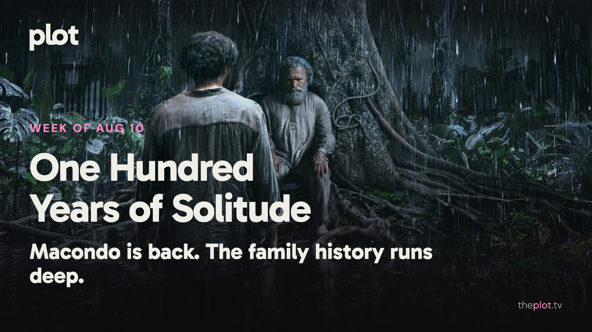

Macondo is back, with enough family history to make your own group chat look manageable. In theaters, *One Night Only* is discovering that a bold dating premise still needs a good date at its center. Streaming brings trapped families and unruly cats; ahead are dinosaurs in suburbia, dinosaurs for preschoolers, and a beekeeper with a much stranger story.

Image: One Hundred Years of Solitude (2024), promotional backdrop. Source: [TMDB](https://www.themoviedb.org/tv/207333). Text overlay by Plot.

## In theaters

Image: One Night Only (2026), promotional backdrop. Source: [TMDB](https://www.themoviedb.org/movie/1433367).

*One Night Only* gives Monica Barbaro and Callum Turner one legally sanctioned night to find romance. [Variety finds the premise more complicated than the film can handle](https://au.variety.com/2026/film/news/one-night-only-film-review-39171/). A high-concept date movie with an unusually large amount to explain.

[Jane Schoenbrun's *Teenage Sex and Death at Camp Miasma*](https://mubi.com/en/campmiasma) folds filmmaking and desire into a horror story. Hannah Einbinder and Gillian Anderson lead. The alternative for viewers who want a movie that might follow them home in a less literal way.

*Spider-Man: Brand New Day* is [Tom Holland's return to a more isolated Peter Parker](https://www.youtube.com/watch?v=8TZMtslA3UY). Saving the city is one job; rebuilding a life is another. The familiar blockbuster choice for a group with very different appetites for the rest of this week's releases.

## What everyone's talking about

*One Hundred Years of Solitude* has reopened the adaptation question: how much of a novel lives in the telling rather than the events? [The Independent admires the series' visual reach but finds its boundary between ordinary life and magic less fluid than the book's](https://www.the-independent.com/arts-entertainment/tv/reviews/one-hundred-years-solitude-netflix-review-b3027334.html). [Moneycontrol responds more warmly to the care in Macondo's decline](https://www.moneycontrol.com/entertainment/one-hundred-years-of-solitude-part-2-review-gabriel-garc-a-m-rquez-s-macondo-s-beautiful-decline-is-captured-with-heart-and-care-article-13998422.html). Both reactions make the same invitation more specific. Come for a richly imagined family saga; decide for yourself whether seeing this world makes it more tangible or less mysterious.

*One Night Only* has prompted a conversation about what happens when a sex comedy starts negotiating its own limits. In a [film-podcast community discussion](https://www.reddit.com/r/TheBigPicture/comments/1vj02ep/one_night_only_spreadsheet_vs_spreadsheet/), viewers debate the reported test-screening response and the idea of designing a film around audience feedback. That thread is a debate, not proof of what caused the finished film's problems. But the question is worth carrying into the movie: if your premise promises a night unlike ordinary life, how cautious can the comedy afford to be?

GIF: A family trying to act normal while something enormous happens outside. Savannah to choose the GIF.

## Now on TV and Streaming

Image: The Last House (2026), promotional backdrop. Source: [TMDB](https://www.themoviedb.org/movie/1284041).

*The Last House* is [Netflix's new sci-fi thriller about a family trapped at home](https://media.netflix.com/en/only-on-netflix/81914143). Greta Lee and Wagner Moura face shrinking resources and an unclear threat. For the evening when a single unsettling setup is enough to get you pressing play.

Image: Ricky Gervais Alley Cats (2026), promotional backdrop. Source: [TMDB](https://www.themoviedb.org/tv/300480).

[Netflix's adult animated series *Ricky Gervais Alley Cats*](https://media.netflix.com/en/only-on-netflix/81658840) follows feral British cats causing trouble. The draw is bad behavior in a compact cartoon package. The animals are not an indication that this is the children's choice.

## Coming up

TRAILER: https://www.youtube.com/watch?v=3oB9AxspVow

*The End of Oak Street* opens Friday, August 14. A neighborhood is transported somewhere very wrong in David Robert Mitchell's film. Anne Hathaway and Ewan McGregor have a family to protect. The summer adventure for anyone who has ever felt their suburb needed more dinosaurs.

TRAILER: https://www.youtube.com/watch?v=xgI5iYmOf5Q

*PAW Patrol: The Dino Movie* opens Friday, August 14. The animated rescue crew heads for a dinosaur adventure. For the smaller moviegoer who wants the prehistoric creatures without the adults looking worried about the rating.

TRAILER: https://www.youtube.com/watch?v=GwSvAyaMGMo

*The Rivals of Amziah King* opens Friday, August 14. Matthew McConaughey plays a beekeeper and bandleader in the Oklahoma-set film. Music, a makeshift family, and a crime story give this a flavor well outside the superhero menu.

## The charts

Your trending top ten for August 10, 2026.

1. [*Spider-Man: Brand New Day*](https://theplot.tv/movie/spider-man-brand-new-day-969681), film. Up 6 this week
2. [*Supergirl*](https://theplot.tv/movie/supergirl-1081003), film. New on the chart this week
3. [*The Odyssey*](https://theplot.tv/movie/the-odyssey-1368337), film. Down 2 this week
4. [*Obsession*](https://theplot.tv/movie/obsession-1339713), film. Up 1 this week
5. [*The Devil's Mouth*](https://theplot.tv/movie/the-devil-s-mouth-1481343), film. New on the chart this week
6. [*Avatar Aang: The Last Airbender*](https://theplot.tv/movie/avatar-aang-the-last-airbender-980431), film. Up 8 this week
7. [*Disclosure Day*](https://theplot.tv/movie/disclosure-day-1275779), film. Down 5 this week
8. [*Backrooms*](https://theplot.tv/movie/backrooms-1083381), film. Down 2 this week
9. [*Bleach*](https://theplot.tv/tv/bleach-30984), TV. Up 3 this week
10. [*Masters of the Universe*](https://theplot.tv/movie/masters-of-the-universe-454639), film. Down 6 this week

Want more? [See the full top 20 chart on Plot](https://theplot.tv/whats-on/chart).

Chart snapshot: 2026-08-06. Movement compared with 2026-07-30.

## Weekend watch

Image: MOURINHO (2026), promotional backdrop. Source: [TMDB](https://www.themoviedb.org/tv/329274).

*MOURINHO* arrives on Netflix Tuesday, August 11. [The documentary series follows the soccer manager's rise](https://www.netflix.com/tudum/articles/what-to-watch-on-netflix-august-7-2026). Personality and the job of leading other people are the invitation, even if your tactical knowledge stops at recognizing a goal. [Save MOURINHO for the weekend](https://app.theplot.tv/save?media_type=tv&tmdb_id=329274&src=newsletter).

Image: Don't Say Good Luck (2026), promotional backdrop. Source: [TMDB](https://www.themoviedb.org/movie/1504358).

*Don't Say Good Luck* comes to Netflix Friday, August 14. [The teen comedy film follows a high-school stage production colliding with a family crisis](https://media.netflix.com/en/only-on-netflix/81975622). For a weekend choice where theatrical nerves and family uncertainty have to share the spotlight. [Save Don't Say Good Luck for the weekend](https://app.theplot.tv/save?media_type=movie&tmdb_id=1504358&src=newsletter).

Save the ones that suit your mood to your Plot watchlist. Friday-you can decide between them after eating something, which tends to improve most decisions.

Be that friend. Give the group chat its weekend watchlist.

Chart and title artwork: TMDB. This newsletter uses the TMDB API but is not endorsed or certified by TMDB.
