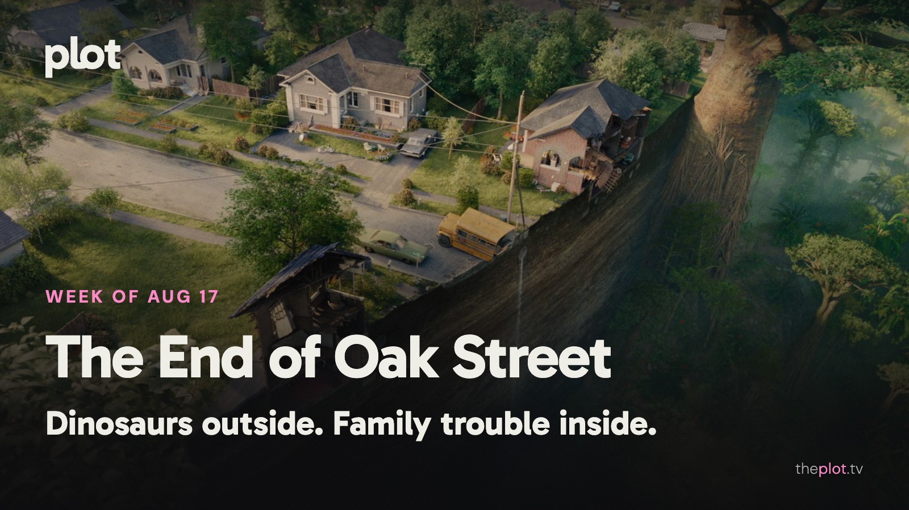

Staying home is having a terrible week. *The End of Oak Street* brings prehistoric trouble to the block, while *The Last House* won't let its family leave at all. Elsewhere, the PAW Patrol has a much gentler dinosaur problem. This weekend makes room for the Pogues' last treasure hunt and the end of *Lucky*'s chase.

Image: The End of Oak Street (2026), promotional backdrop. Source: [TMDB](https://www.themoviedb.org/movie/1101383). Text overlay by Plot.

## In theaters

Image: The End of Oak Street (2026), promotional backdrop. Source: [TMDB](https://image.tmdb.org/t/p/original/b9q9VmbXDvJmTziRqkwdEmFdwhr.jpg).

*The End of Oak Street* turns an ordinary neighborhood into dangerous territory. [AP enjoys its throwback summer-adventure energy](https://apnews.com/article/580777f9f45d34c2775cffb1316fad6b). Anne Hathaway and Ewan McGregor lead a family whose problems have suddenly grown teeth.

[*PAW Patrol: The Dino Movie*](https://www.youtube.com/watch?v=xgI5iYmOf5Q) supplies the weekend's more reassuring dinosaurs. The animated pups have another rescue mission. A sensible separation of audiences from the prehistoric trouble on Oak Street.

[Matthew McConaughey's beekeeper and bandleader anchors *The Rivals of Amziah King*](https://www.youtube.com/watch?v=GwSvAyaMGMo). The Oklahoma-set film combines a surrogate family with music and crime. For viewers who would prefer this week's oddness to arrive through people rather than creatures.

## What everyone's talking about

*The End of Oak Street* has found an audience willing to follow a summer adventure somewhere nastier than the marketing might suggest. The [opening discussion](https://www.reddit.com/r/movies/comments/1vnu9i3/official_discussion_the_end_of_oak_street_spoilers/) is full of enthusiasm for its energy and creature work, alongside arguments about its harsher choices. [RogerEbert.com also welcomes its mix of family feeling and apocalyptic chaos](https://www.rogerebert.com/reviews/the-end-of-oak-street-anne-hathaway-ewan-mcgregor-film-review-2026). The useful distinction is tone. Familiar suburban scenery does not promise a gentle ride. If the trailer suggested a cozy dinosaur outing, leave room for some discomfort.

Image: The Last House (2026), promotional backdrop. Source: [TMDB](https://www.themoviedb.org/movie/1284041).

*The Last House* is generating a smaller, more confined argument: how long can a good premise keep you trapped? [The Houston Chronicle finds Greta Lee and Wagner Moura give the Netflix film weight](https://www.houstonchronicle.com/entertainment/movies_tv/article/the-last-house-netflix-review-22373077.php). [TheWrap sees a familiar lockdown anxiety doing too much of the work](https://www.thewrap.com/creative-content/movies/the-last-house-review-netflix-wagner-moura-greta-lee/). This is a choice about what you enjoy in a thriller. The mystery of the sealed house offers an immediate hook; keeping the people inside it interesting is the longer job.

## Now on TV and Streaming

Image: Don't Say Good Luck (2026), promotional backdrop. Source: [TMDB](https://www.themoviedb.org/movie/1504358).

[*Don't Say Good Luck* is on Netflix](https://media.netflix.com/en/only-on-netflix/81975622). The new teen comedy film puts a stage production alongside a family crisis. For viewers who want a coming-of-age story with more at stake than getting the opening night right.

Image: MOURINHO (2026), promotional backdrop. Source: [TMDB](https://www.themoviedb.org/tv/329274).

[*MOURINHO* is Netflix's new documentary series](https://media.netflix.com/en/only-on-netflix/81762073) about the soccer manager. His career makes room for a large personality as well as results. A sports choice built around the person doing the directing from the sideline.

## Coming up

https://www.youtube.com/watch?v=jxU8FU3o75A

*Insidious: Out of the Further* opens Friday, August 21. The new horror film returns to the franchise's supernatural territory. For fans whose ideal late-summer outing involves entering somewhere that everyone sensible would avoid.

https://www.youtube.com/watch?v=FKSdXH89jbo

*Mutiny* opens Friday, August 21. Jason Statham plays a man framed for murder and pulled into an international conspiracy. A thriller for the audience that enjoys a clear grievance and a star with a very physical complaints procedure.

https://www.youtube.com/watch?v=EjFia8RfeuQ

*The Magic Faraway Tree* opens in US theaters Friday, August 21. The family film sends children into a tree's changing magical worlds. A change of mood from this week's trapped households: here, discovering somewhere new is part of the pleasure.

## The charts

Your trending top ten for August 17, 2026.

1. [*Spider-Man: Brand New Day*](https://theplot.tv/movie/spider-man-brand-new-day-969681), film. No change this week
2. [*The Odyssey*](https://theplot.tv/movie/the-odyssey-1368337), film. Up 1 this week
3. [*The Last House*](https://theplot.tv/movie/the-last-house-1284041), film. New on the chart this week
4. [*Evil Dead Burn*](https://theplot.tv/movie/evil-dead-burn-1212763), film. New on the chart this week
5. [*Obsession*](https://theplot.tv/movie/obsession-1339713), film. Down 1 this week
6. [*Supergirl*](https://theplot.tv/movie/supergirl-1081003), film. Down 4 this week
7. [*Ted Lasso*](https://theplot.tv/tv/ted-lasso-97546), TV. New on the chart this week
8. [*Silo*](https://theplot.tv/tv/silo-125988), TV. Up 3 this week
9. [*Sterling Point*](https://theplot.tv/tv/sterling-point-283297), TV. New on the chart this week
10. [*House of the Dragon*](https://theplot.tv/tv/house-of-the-dragon-94997), TV. Up 3 this week

Want more? [See the full top 20 chart on Plot](https://theplot.tv/whats-on/chart).

Chart snapshot: 2026-08-13. Movement compared with 2026-08-06.

## Weekend watch

Image: Outer Banks (2020), promotional backdrop. Source: [TMDB](https://www.themoviedb.org/tv/100757).

*Outer Banks* returns to Netflix Thursday, August 20. [The series' fifth and final season gives the Pogues one last adventure](https://www.netflix.com/tudum/articles/what-to-watch-on-netflix-august-14-2026). Pick this when you are ready to say goodbye to a group whose best intentions rarely produce a sensible plan. [Save Outer Banks for the weekend](https://app.theplot.tv/save?media_type=tv&tmdb_id=100757&src=newsletter).

Image: Lucky (2026), promotional backdrop. Source: [TMDB](https://www.themoviedb.org/tv/278624).

*Lucky* finishes its seven-episode run on Apple TV Wednesday, August 19. [The series follows Anya Taylor-Joy's fugitive through a criminal past she wants to escape](https://www.apple.com/tv-pr/originals/lucky/). Now the wait between installments is over. For the viewer who saves a chase thriller until the whole chase is there. [Save Lucky for the weekend](https://app.theplot.tv/save?media_type=tv&tmdb_id=278624&src=newsletter).

Give your Plot watchlist two good possibilities before Friday arrives. It is much easier to choose a mood than to audition an entire streaming service.

Be that friend. Give the group chat its weekend watchlist.

Chart and title artwork: TMDB. This newsletter uses the TMDB API but is not endorsed or certified by TMDB.
