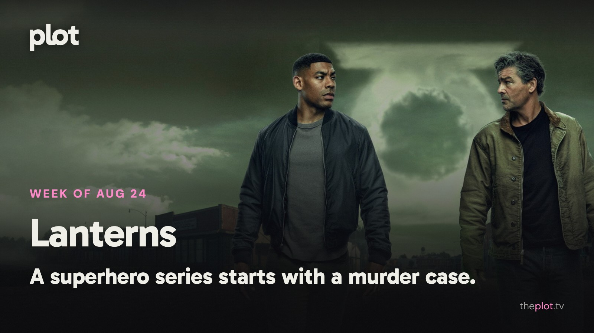

*Lanterns* is investigating a murder, *Outer Banks* is taking its final bow, and neither group seems likely to clear the schedule early. In theaters, Jason Statham has another reason to be furious. Coming Friday: a coyote with a legal claim, survivors looking beyond the end of the world, and a missing-child thriller with an ominously familiar case.

Image: Lanterns (2026), promotional backdrop. Source: [TMDB](https://www.themoviedb.org/tv/95350). Text overlay by Plot.

## In theaters

Image: Mutiny (2026), promotional backdrop. Source: [TMDB](https://www.themoviedb.org/movie/1288445).

[*Mutiny* gives Jason Statham a murder accusation and an international conspiracy](https://www.youtube.com/watch?v=FKSdXH89jbo). The new action thriller is a useful answer to the friend who wants a movie where the lead solves problems directly. Very directly.

[*Insidious: Out of the Further*](https://www.youtube.com/watch?v=jxU8FU3o75A) brings another encounter with the franchise's dangerous supernatural realm. For the group that already knows it enjoys these particular scares. Familiarity is not much protection for the people inside the film.

[The suburban family in *The End of Oak Street*](https://www.youtube.com/watch?v=3oB9AxspVow) is still having a far worse summer than yours. David Robert Mitchell sends a whole neighborhood into the unknown. An original large-screen adventure for anyone wanting a break from a recognizable franchise logo.

## What everyone's talking about

*Lanterns* has a strong opening argument for a superhero series: make the audience care about a case before asking them to learn a universe. [Le Monde reads its leads as flawed people rather than polished saviors](https://www.lemonde.fr/en/culture/article/2026/08/21/lanterns-on-hbo-max-not-your-shiny-saviors_6756717_30.html). [TVLine likes the early grit and chemistry but finds comic-book lore crowding in](https://www.tvline.com/2236789/lanterns-review-hbo-dc-comics-kyle-chandler/). That makes a useful expectation for the HBO series. The rural murder mystery is the entry point; whether you want the larger mythology that follows may decide how long you stay.

Image: Outer Banks (2020), promotional backdrop. Source: [TMDB](https://www.themoviedb.org/tv/100757).

*Outer Banks* was never where you went for calm judgment. Its final season now has to turn years of impulsive adventure into a goodbye. [TheWrap finds an entertaining but overfilled conclusion](https://www.thewrap.com/creative-content/reviews/outer-banks-season-5-review-netflix/). In a [fan discussion after the finale](https://www.reddit.com/r/OuterBanksNetflix/comments/1vv002k/just_finished_season_5_and_wow/), affection for the ride meets frustration with the writing. Those feelings can coexist. Fans aren't only evaluating a treasure-hunt plot; they are deciding whether the ending makes good use of the time they spent with these people.

## Now on TV and Streaming

Image: Facing El Chapo (2026), promotional backdrop. Source: [TMDB](https://www.themoviedb.org/movie/1621552).

[*Facing El Chapo* is Netflix's new crime film](https://media.netflix.com/en/only-on-netflix/82048151). Two officers cross a cartel boss and have to survive the rest of their shift. A compact setup for the viewer who likes a workday thriller with absolutely no possibility of clocking off on time.

[*Outer Banks*' final season is on Netflix](https://media.netflix.com/en/only-on-netflix/80236318). The treasure-hunting friends are nearing the end of their story. A catch-up project for the viewer who wants one last visit with the Pogues before closing that particular tab.

## Coming up

https://www.youtube.com/watch?v=H-43VeYGiPM

*Coyote vs. Acme* opens Friday, August 28. Wile E. Coyote hires a lawyer to sue the company behind his defective gadgets. Will Forte joins the live-action and animation mix. For anyone who has watched one too many failed rocket skates and wondered about the warranty.

https://www.youtube.com/watch?v=cmzVY1goqwQ

*The Dog Stars* opens Friday, August 28. Ridley Scott's film follows a pilot surviving after a pandemic. Jacob Elordi leads. The attraction is a search for human connection inside a survival story, rather than simply another empty world to flee through.

https://www.youtube.com/watch?v=ZHRR-1CKYIQ

*The Whisper Man* arrives on Netflix Friday, August 28. A missing child draws a writer and his estranged detective father together. Adam Scott and Robert De Niro lead the film. A serial-killer mystery with a damaged family at its center.

## The charts

Your trending top ten for August 24, 2026.

1. [*Spider-Man: Brand New Day*](https://theplot.tv/movie/spider-man-brand-new-day-969681), film. No change this week
2. [*The Odyssey*](https://theplot.tv/movie/the-odyssey-1368337), film. No change this week
3. [*Minions & Monsters*](https://theplot.tv/movie/minions-monsters-1315772), film. New on the chart this week
4. [*The Last House*](https://theplot.tv/movie/the-last-house-1284041), film. Down 1 this week
5. [*Reacher*](https://theplot.tv/tv/reacher-108978), TV. New on the chart this week
6. [*The Invite*](https://theplot.tv/movie/the-invite-950028), film. New on the chart this week
7. [*House of the Dragon*](https://theplot.tv/tv/house-of-the-dragon-94997), TV. Up 3 this week
8. [*The End of Oak Street*](https://theplot.tv/movie/the-end-of-oak-street-1101383), film. New on the chart this week
9. [*Obsession*](https://theplot.tv/movie/obsession-1339713), film. Down 4 this week
10. [*Silo*](https://theplot.tv/tv/silo-125988), TV. Down 2 this week

Want more? [See the full top 20 chart on Plot](https://theplot.tv/whats-on/chart).

Chart snapshot: 2026-08-20. Movement compared with 2026-08-13.

## Weekend watch

Image: All the Truth in My Lies (2026), promotional backdrop. Source: [TMDB](https://www.themoviedb.org/tv/292558).

*All the Truth in My Lies* arrives on Netflix Friday, August 28. [The Spanish series sends two roommates on a bachelorette road trip with unresolved feelings](https://media.netflix.com/en/only-on-netflix/81735486). For the night when everyone in the group seems to be keeping one important thing to themselves. [Save All the Truth in My Lies for the weekend](https://app.theplot.tv/save?media_type=tv&tmdb_id=292558&src=newsletter).

Image: Leanne (2025), promotional backdrop. Source: [TMDB](https://www.themoviedb.org/tv/252751).

*Leanne* returns to Netflix Thursday, August 27. [Season two brings more family interference and a life being rebuilt after marriage](https://www.netflix.com/tudum/articles/what-to-watch-on-netflix-august-21-2026). A sitcom for when you want company, jokes, and problems that don't require learning a criminal hierarchy. [Save Leanne for the weekend](https://app.theplot.tv/save?media_type=tv&tmdb_id=252751&src=newsletter).

Save these to your Plot watchlist now. By Friday, choosing something should feel like opening a good menu, not doing another shift.

Be that friend. Give the group chat its weekend watchlist.

Chart and title artwork: TMDB. This newsletter uses the TMDB API but is not endorsed or certified by TMDB.
