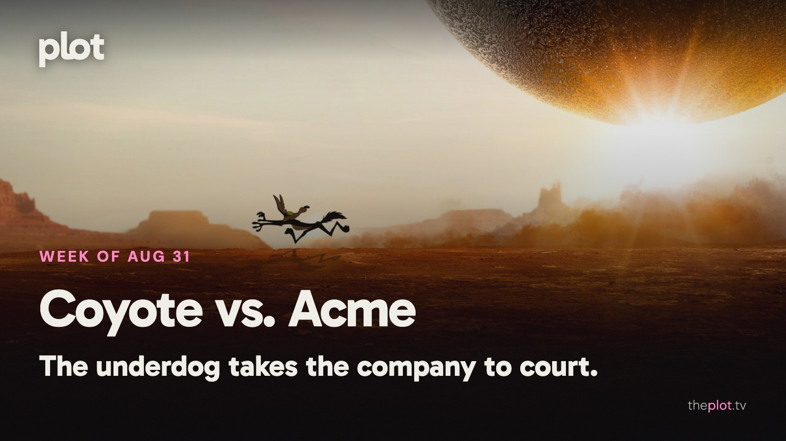

Wile E. Coyote has stopped ordering gadgets and started asking for legal advice. *Coyote vs. Acme* is finally in theaters, alongside Ridley Scott's survivors in *The Dog Stars*. At home, *The Whisper Man* has a less welcoming reception. September begins with a Cold War odd couple, a high-pressure errand, and two documentaries looking past a familiar headline.

Image: Coyote vs. Acme (2026), promotional backdrop. Source: [TMDB](https://www.themoviedb.org/movie/1204680). Text overlay by Plot.

## In theaters

Image: Coyote vs. Acme (2026), promotional backdrop. Source: [TMDB](https://image.tmdb.org/t/p/original/viZqGq9TNvQ5uXSD4ahg2RpRONT.jpg).

*Coyote vs. Acme* finally gives the cartoon underdog someone else to blame. [Time Out enjoys the comedy's frantic energy](https://www.timeout.com/movies/coyote-vs-acme-review-2026). A lawsuit over faulty products is a very sensible development after decades of exploding equipment.

[Ridley Scott's *The Dog Stars*](https://www.20thcenturystudios.com/movies/the-dog-stars) follows survivors of a pandemic, with Jacob Elordi as a pilot looking beyond the life he has managed to preserve. A quieter human reason to enter an enormous postapocalyptic landscape.

[*Mutiny* keeps Jason Statham in action-thriller territory](https://www.youtube.com/watch?v=FKSdXH89jbo). Framed for murder, he has to fight his way through a conspiracy. For the cinema group that would like its plot delivered with physical punctuation.

## What everyone's talking about

*Coyote vs. Acme* is getting a hearing as a movie, rather than only as the film that almost disappeared. [Sight and Sound finds a sharp corporate satire inside the cartoon courtroom story](https://www.bfi.org.uk/sight-and-sound/reviews/coyote-vs-acme-toon-courtroom-drama-one-smartest-critiques-us-politics-years). The [review discussion](https://www.reddit.com/r/boxoffice/comments/1vxylw6/coyote_vs_acme_review_thread/) carries the relief and enthusiasm surrounding its release. The important step is moving past gratitude that it exists. A company that sells endless solutions to a customer who never gets what he wants is a joke with plenty of life outside animation. The backstory is extraordinary; the premise can stand on its own.

Image: The Whisper Man (2026), promotional backdrop. Source: [TMDB](https://www.themoviedb.org/movie/860508).

*The Whisper Man* has a cast that can sell a thriller before the first scene. That makes the response to the Netflix film more disappointing. [RogerEbert.com faults its familiar mystery and thin characterization](https://www.rogerebert.com/reviews/the-whisper-man-robert-de-niro-adam-scott-netflix-movie-review-2026), while [The A.V. Club also finds it dull](https://www.avclub.com/the-whisper-man-review). The criticism points to execution rather than a shortage of ingredients. A kidnapped child, a fractured family, and a retired detective are a starting point. They still need to become people and a case worth following.

## Now on TV and Streaming

[*The Whisper Man* is on Netflix](https://media.netflix.com/en/only-on-netflix/81278442). Adam Scott plays a father whose missing son leads him back to his estranged detective father, played by Robert De Niro. The new film is for the viewer still intrigued by a family secret wrapped around a criminal case.

Image: Leanne (2025), promotional backdrop. Source: [TMDB](https://www.themoviedb.org/tv/252751).

[*Leanne*'s second season is now on Netflix](https://media.netflix.com/en/only-on-netflix/81752004). Family roles keep changing as its heroine rebuilds her life. The lighter option when your evening would benefit from a sister on the sofa rather than a detective at the door.

## Coming up

https://www.youtube.com/watch?v=om5Un9X720M

*Mayday* arrives on Apple TV Friday, September 4. Ryan Reynolds plays an American pilot stranded in Soviet territory, with Kenneth Branagh as an unlikely ally. The action-comedy offers a Cold War escape plan built around mismatched personalities.

https://www.youtube.com/watch?v=L24CYVpQ-LI

*Onslaught* opens Friday, September 4. Adam Wingard's new film puts a mother up against a strange threat at a secret facility. Adria Arjona leads. For the viewer whose late-summer thriller preference is loud, physical, and increasingly out of control.

https://www.youtube.com/watch?v=zz4rsZLcauY

*The Runner* reaches Prime Video Wednesday, September 2. The film sends a courier through London with a package and a dangerous deadline. A night of motion for anyone who prefers the stakes of a thriller to fit inside something one person can carry.

## The charts

Your trending top ten for August 31, 2026.

1. [*Lanterns*](https://theplot.tv/tv/lanterns-95350), TV. New on the chart this week
2. [*Toy Story 5*](https://theplot.tv/movie/toy-story-5-1084244), film. New on the chart this week
3. [*Spider-Man: Brand New Day*](https://theplot.tv/movie/spider-man-brand-new-day-969681), film. Down 2 this week
4. [*Mutiny*](https://theplot.tv/movie/mutiny-1288445), film. New on the chart this week
5. [*The Odyssey*](https://theplot.tv/movie/the-odyssey-1368337), film. Down 3 this week
6. [*Reacher*](https://theplot.tv/tv/reacher-108978), TV. Down 1 this week
7. [*Silo*](https://theplot.tv/tv/silo-125988), TV. Up 3 this week
8. [*Obsession*](https://theplot.tv/movie/obsession-1339713), film. Up 1 this week
9. [*Insidious: Out of the Further*](https://theplot.tv/movie/insidious-out-of-the-further-1291595), film. New on the chart this week
10. [*Minions & Monsters*](https://theplot.tv/movie/minions-monsters-1315772), film. Down 7 this week

Want more? [See the full top 20 chart on Plot](https://theplot.tv/whats-on/chart).

Chart snapshot: 2026-08-27. Movement compared with 2026-08-20.

## Weekend watch

Image: Turning Point: Generation 9/11 (2026), promotional backdrop. Source: [TMDB](https://www.themoviedb.org/movie/1752159).

*Turning Point: Generation 9/11* arrives on Netflix Wednesday, September 2. [The documentary film considers the attacks through the generation shaped by them](https://media.netflix.com/en/only-on-netflix/82091553). Choose a quieter evening for this one, with room to think after the credits. [Save Turning Point: Generation 9/11 for the weekend](https://app.theplot.tv/save?media_type=movie&tmdb_id=1752159&src=newsletter).

Image: Untold: Raygun - Breaking Badly (2026), promotional backdrop. Source: [TMDB](https://www.themoviedb.org/movie/1739202).

*Untold: Raygun - Breaking Badly*. *Untold Raygun: Breaking Badly* reaches Netflix Tuesday, September 1. [The documentary film follows the Olympic breakdancer whose performance became a global meme](https://www.youtube.com/watch?v=OCZg5l9BfRg). For anyone curious about the person left living with a joke after everyone else has scrolled away. [Save Untold: Raygun - Breaking Badly for the weekend](https://app.theplot.tv/save?media_type=movie&tmdb_id=1739202&src=newsletter).

Save these to your Plot watchlist before the long weekend makes choosing anything feel optional. A small shortlist is a very nice thing to inherit from your Monday self.

Be that friend. Give the group chat its weekend watchlist.

Chart and title artwork: TMDB. This newsletter uses the TMDB API but is not endorsed or certified by TMDB.
