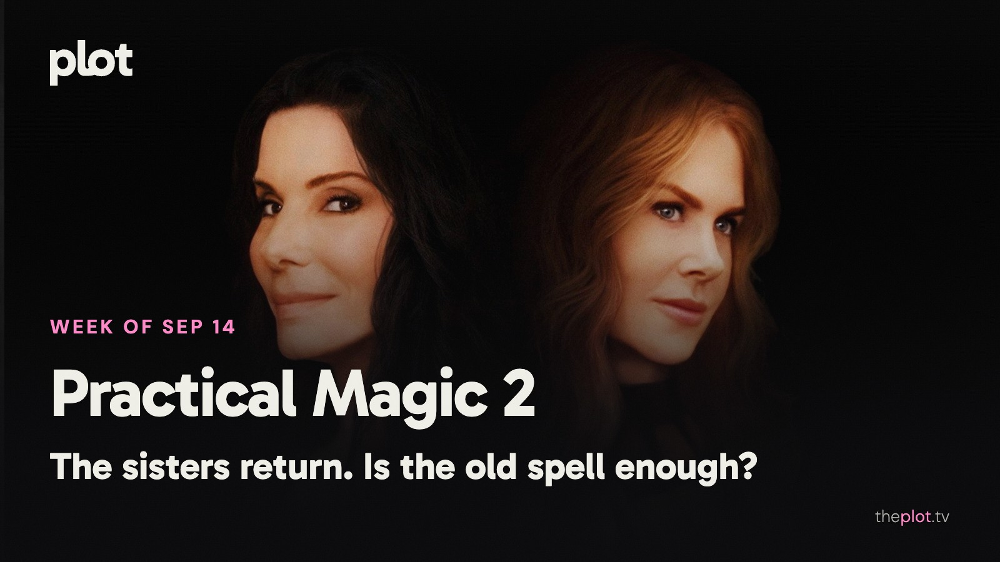

The Owens sisters are back, and the conversation is about what a reunion owes the people who waited for it. *Silo* has given patient viewers a different kind of payoff. Meanwhile, Netflix has competitive athletes and an office retreat gone wrong, with *Resident Evil*, Ethan Hawke's wilderness trek, and Neagley's own investigation just ahead.

Image: Practical Magic 2 (2026), promotional backdrop. Source: [TMDB](https://www.themoviedb.org/movie/1302904). Text overlay by Plot.

## In theaters

Image: Practical Magic 2 (2026), promotional backdrop. Source: [TMDB](https://image.tmdb.org/t/p/original/oIglj0Jy9duG4LnrRUpH8n001Pk.jpg).

*Practical Magic 2* reunites Sandra Bullock and Nicole Kidman as the Owens sisters. [TheWrap finds a flawed but appealing reunion](https://www.thewrap.com/creative-content/reviews/practical-magic-2-review/). The draw is the company, with the family curse supplying another reason to stay together.

[Na Hong-jin's *Hope*](https://www.neonrated.com/film/hope) turns an extraordinary discovery near a remote village into a threat. From the director of *The Wailing*, the film is a choice for an audience comfortable not knowing quite what kind of trouble it has entered.

[*Runner*](https://www.angel.com/movies/runner) puts a donor organ in transit and a life at the far end of the journey. The new thriller makes an urgent delivery its central problem. For the night when a clear deadline is all the invitation you need.

## What everyone's talking about

*Practical Magic 2* is asking whether the pleasure of being reunited can carry a whole movie. [WBUR argues that the sequel moves away from the camaraderie that made the original a good hang](https://www.wbur.org/news/2026/09/10/practical-magic-2-review). In the [early review discussion](https://www.reddit.com/r/boxoffice/comments/1wasi9e/practical_magic_2_review_thread/), the expectation of sisterly chemistry runs alongside skepticism about another legacy sequel. The original also grew beyond its initial reception, so a critic's dislike is hardly the end of this story. Still, wanting these women back is different from being satisfied with what the film gives them to do.

Image: Silo (2023), promotional backdrop. Source: [TMDB](https://www.themoviedb.org/tv/125988).

*Silo* is a useful reminder that patience and momentum aren't always enemies. [SciFiNow welcomes the third season's answers and expanded perspective](https://www.scifinow.co.uk/reviews/silo-season-3-review-apple-tv-plus/). A [fan defense of the season](https://www.reddit.com/r/SiloSeries/comments/1voq4m1/hot_take_i_like_season_3/) meets replies debating the buildup and the balance between its storylines. That argument belongs to the experience of a weekly mystery: an installment can feel slow in isolation and different once the next piece arrives. For viewers who prefer waiting until there is more to work with, the Apple TV series is worth putting back on the list.

GIF: An enthusiastic reunion interrupted by a familiar old problem. Savannah to choose the GIF.

## Now on TV and Streaming

Image: Go Team! (2026), promotional backdrop. Source: [TMDB](https://www.themoviedb.org/movie/1558568).

[*Go Team!* is Netflix's new Spanish comedy film](https://media.netflix.com/en/only-on-netflix/81712065). A cheese company's staff retreat is downgraded, then the prospect of layoffs makes everything worse. For anyone who hears "team-building" and immediately starts looking for the exit.

Image: Physical 100: Italy (2026), promotional backdrop. Source: [TMDB](https://www.themoviedb.org/tv/324111).

[Netflix's *Physical 100: Italy*](https://media.netflix.com/en/only-on-netflix/81771552) is a new competition series built around a hundred athletes. The challenges make very different kinds of strength compete. Ideal viewing for finding an unexpected favorite while maintaining your own excellent seated form.

## Coming up

TRAILER: https://www.youtube.com/watch?v=mNd1gb19A-c

*Resident Evil* opens Friday, September 18. Zach Cregger's film sends a medical courier into a disastrous night. The director of *Barbarian* brings horror instincts to the game series. For viewers who want vulnerability and panic before they want a familiar weapon.

TRAILER: https://www.youtube.com/watch?v=7YpuMymmiJ8

*The Weight* opens Friday, September 18. Ethan Hawke leads a Depression-era wilderness thriller involving stolen gold. The journey offers rough terrain and unreliable companions. A ticket for anyone whose favorite suspense starts with a very bad bargain.

TRAILER: https://www.youtube.com/watch?v=BOzNaa_o9_g

*Neagley* comes to Prime Video Wednesday, September 16. Maria Sten's character from *Reacher* leads her own crime series. For viewers who have been waiting to see what happens when the capable person beside the hero becomes the person driving the investigation.

## The charts

Your trending top ten for September 14, 2026.

1. [*The Runner*](https://theplot.tv/movie/the-runner-1386315), film.
2. [*Silo*](https://theplot.tv/tv/silo-125988), TV.
3. [*The Whisper Man*](https://theplot.tv/movie/the-whisper-man-860508), film.
4. [*The Odyssey*](https://theplot.tv/movie/the-odyssey-1368337), film.
5. [*Coyote vs. Acme*](https://theplot.tv/movie/coyote-vs-acme-1204680), film.
6. [*Spider-Man: Brand New Day*](https://theplot.tv/movie/spider-man-brand-new-day-969681), film.
7. [*The Gentlemen*](https://theplot.tv/tv/the-gentlemen-236235), TV.
8. [*Lanterns*](https://theplot.tv/tv/lanterns-95350), TV.
9. [*Obsession*](https://theplot.tv/movie/obsession-1339713), film.
10. [*Reacher*](https://theplot.tv/tv/reacher-108978), TV.

Want more? [See the full top 20 chart on Plot](https://theplot.tv/whats-on/chart).

Chart snapshot: 2026-09-10. Movement omitted because the preceding saved snapshot is not from the prior week.

## Weekend watch

Image: Slow Horses (2022), promotional backdrop. Source: [TMDB](https://www.themoviedb.org/tv/95480).

*Slow Horses* returns to Apple TV Wednesday, September 16. [Season six puts Jackson Lamb's rejected spies on the run](https://www.apple.com/tv-pr/news/2026/08/apple-tv-debuts-enthralling-trailer-for-season-six-of-emmy-and-bafta-award-winning-espionage-drama-slow-horses-starring-academy-award-winner-sir-gary-oldman/). A welcome return for anyone who likes their espionage clever and their office politics extremely unhygienic. [Save Slow Horses for the weekend](https://app.theplot.tv/save?media_type=tv&tmdb_id=95480&src=newsletter).

Image: Best of the Best (2026), promotional backdrop. Source: [TMDB](https://www.themoviedb.org/movie/1514863).

*Best of the Best* arrives on Netflix Friday, September 18. [The film follows childhood friends joining a competitive Bollywood-fusion dance team at UCLA](https://www.netflix.com/tudum/articles/best-of-the-best-plot-cast-release-date-news). Friendship and ambition have to learn the same routine. For the part of you that will always make time for a dance movie. [Save Best of the Best for the weekend](https://app.theplot.tv/save?media_type=movie&tmdb_id=1514863&src=newsletter).

Put these on your Plot watchlist before the week gets away from you. Friday-you can bring the snacks; today's version can at least supply a plan.

Be that friend. Give the group chat its weekend watchlist.

Chart and title artwork: TMDB. This newsletter uses the TMDB API but is not endorsed or certified by TMDB.
