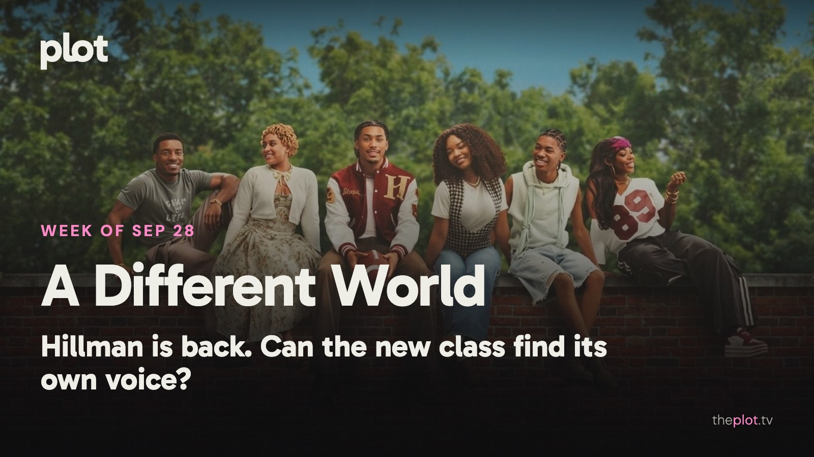

Hillman College has reopened, and the welcome comes with a familiar question: how much past can a new show carry? *Forgotten Island* gives another friendship a much stranger test. Meanwhile, *UNABOMBER* and *The Final Problem* are on Netflix, Tom Cruise has an apocalypse to answer for on Friday, and the weekend has room for pirates made of LEGO and a fake relationship with very real complications.

Image: A Different World (2026), promotional backdrop. Source: [TMDB](https://www.themoviedb.org/tv/305357). Text overlay by Plot.

## In theaters

*Forgotten Island* is DreamWorks' new friendship adventure, with Filipino folklore shaping the world its two leads have to escape. [AP finds an affectionate, imaginative story in that journey](https://apnews.com/article/9bec293d914478bb4ef21fd8dd35116f). A family outing with an emotional bill for the adults.

*Heart of the Beast* sends Brad Pitt and a combat dog on a very bad trip through Alaska. Its [roughly $20 million domestic debut over September 25-27 put it third for the weekend](https://www.boxofficemojo.com/weekend/2026W39/), behind the *Avengers: Endgame* re-release and *Resident Evil* in its second week. The survival thriller has a straightforward emotional advantage: you will want the dog to get home.

*Primetime* is [now in theaters from A24](https://www.youtube.com/watch?v=5fHXyqQOKL8), with Robert Pattinson leading Lance Oppenheim's move into narrative filmmaking. If your weekend movie needs fewer creatures and more human discomfort, this is the change of pace.

## What everyone's talking about

*A Different World* is back at Hillman, but the biggest change is how it feels to spend time there. The original could tackle something serious and still send you out laughing. This sequel leans harder into campus crises and relationship drama. [TVLine finds that shift leaves too little room for the old comic spark](https://www.tvline.com/2266331/a-different-world-review-netflix-reboot/), even while praising Maleah Joi Moon's energy as Deborah. That gives returning viewers a better question than whether the cast still looks familiar: did you come back for these people, or for the way they used to make you feel?

*Forgotten Island* is prompting a conversation about being represented without being sold a cultural obligation. In a [Filipino audience discussion](https://www.reddit.com/r/Philippines/comments/1wq7zz6/this_movie_deserves_better_than_becoming_a_box/), the opening post describes going in wary of the marketing and coming out won over by the friendship; replies also question whether the posters communicated the film's appeal. [Fresh Fiction celebrates its affection for eccentric girls and the bond between its leads](https://freshfiction.tv/forgotten-island-review-a-fantastic-fantastical-animated-adventure-heartfelt-ode-to-female-friendship/). The folklore gives the adventure its identity. The fear of losing your best friend gives someone outside that culture a way in. [Find Forgotten Island on Plot](https://theplot.tv/movie/forgotten-island-1465063).

## Now on TV and Streaming

Image: UNABOMBER (2026), promotional backdrop. Source: [TMDB](https://www.themoviedb.org/movie/1492640).

*UNABOMBER* is [on Netflix from September 25](https://www.netflix.com/tudum/articles/unabomber-release-date-cast-news). Jacob Tremblay plays the young Ted Kaczynski in a drama that moves between his early life and the hunt for him. For viewers drawn to the making of a notorious figure, rather than a case presented only from the investigators' side.

Image: The Final Problem (2026), promotional backdrop. Source: [TMDB](https://www.themoviedb.org/tv/290720).

*The Final Problem* traps a fading actor in a hotel with an actual suspicious death. His old detective role suddenly becomes a job description. [The Spanish mystery arrived on Netflix September 25](https://about.netflix.com/en/news/the-final-problem-arrives-on-netflix-on-september-25). Save it for the mood where everyone is a suspect and you intend to announce your theory far too early.

Image: A Different World (2026), promotional backdrop. Source: [TMDB](https://image.tmdb.org/t/p/original/1lVbKPOVjTV02FtLqiPk9F9z1Fh.jpg).

*A Different World* follows Deborah Wayne, the daughter of Dwayne and Whitley, into her own freshman year at Hillman. [The new Netflix series began September 24](https://www.netflix.com/tudum/articles/new-young-adult-shows-movies). The original's fans have familiar faces to welcome back; new viewers have friendships, ambition, and the problem of growing up under someone else's reputation.

Less scrolling. Better watching. Your weekly guide to what's on, what's coming, and what's actually worth your time.

## Coming up

https://www.youtube.com/watch?v=job8V254NAE

*Digger* opens Friday, October 2. Tom Cruise plays a powerful man trying to sell himself as humanity's savior after helping create the disaster. [Alejandro G. Iñárritu directs the VistaVision production](https://www.the-numbers.com/movie/Digger-%282026%29). The attraction is Cruise outside his usual rescue mission: this time, the man offering salvation is part of the problem.

https://www.youtube.com/watch?v=xdPMKhjMSFs

*Verity* also opens Friday, October 2. Dakota Johnson plays a writer hired to finish another author's books, only to enter a household full of secrets. [The Colleen Hoover adaptation is on the October 2 release calendar](https://www.boxofficemojo.com/calendar/2026-10-02/). Anne Hathaway plays the author whose story may be the most dangerous thing in the house. For the book-club friend who wants everyone to argue afterward.

https://www.youtube.com/watch?v=M9NWvGZViCg

*East of Eden* arrives on Netflix Thursday, October 1. Florence Pugh plays Cathy Ames in Zoe Kazan's adaptation of Steinbeck's family saga. [The streaming preview introduces its California setting and feuding brothers](https://www.netflix.com/tudum/articles/what-to-watch-on-netflix-september-25-2026). Big feelings, bad decisions, and enough family history to make your own group chat look peaceful.

## The charts

Your trending top ten for September 28, 2026.

1. [*Resident Evil*](https://theplot.tv/movie/resident-evil-1423191), film. Up 17 this week
2. [*The End of Oak Street*](https://theplot.tv/movie/the-end-of-oak-street-1101383), film. New on the chart this week
3. [*Reacher*](https://theplot.tv/tv/reacher-108978), TV. Up 3 this week
4. [*Neagley*](https://theplot.tv/tv/neagley-273207), TV. New on the chart this week
5. [*Monster: The Lizzie Borden Story*](https://theplot.tv/tv/monster-the-lizzie-borden-story-299939), TV. New on the chart this week
6. [*Spider-Man: Brand New Day*](https://theplot.tv/movie/spider-man-brand-new-day-969681), film. Down 2 this week
7. [*Lanterns*](https://theplot.tv/tv/lanterns-95350), TV. Down 2 this week
8. [*MobLand*](https://theplot.tv/tv/mobland-247718), TV. New on the chart this week
9. [*The Scandal*](https://theplot.tv/tv/the-scandal-275102), TV. New on the chart this week
10. [*The Odyssey*](https://theplot.tv/movie/the-odyssey-1368337), film. Down 7 this week

Want more? [See the full top 20 chart on Plot](https://theplot.tv/whats-on/chart).

Chart snapshot: 2026-09-24. Movement compared with 2026-09-17.

## Weekend watch

Image: LEGO ONE PIECE (2026), promotional backdrop. Source: [TMDB](https://www.themoviedb.org/tv/318918).

*LEGO ONE PIECE* arrives on Netflix Tuesday, September 29. Usopp recounts the Straw Hats' early adventures in a two-part special. [Netflix's September lineup confirms the date](https://www.netflix.com/tudum/articles/new-on-netflix?pubDate=20250502). For the household that would like a pirate adventure without signing up for hundreds of episodes this weekend. [Save LEGO ONE PIECE for a shorter voyage](https://app.theplot.tv/save?media_type=tv&tmdb_id=318918&src=newsletter).

Image: The Love Hypothesis (2026), promotional backdrop. Source: [TMDB](https://www.themoviedb.org/movie/1032863).

*The Love Hypothesis* arrived on Prime Video September 23. A Ph.D. candidate gets herself into a fake relationship with an intimidating professor. [Amazon's September guide introduces the adaptation of Ali Hazelwood's novel](https://www.aboutamazon.com/news/entertainment/prime-video-september-films-shows-sports-2026). A romance for anyone who enjoys watching carefully negotiated rules become inconvenient. [Save The Love Hypothesis for the rom-com vote](https://app.theplot.tv/save?media_type=movie&tmdb_id=1032863&src=newsletter).

Image: Doing Life (2026), promotional backdrop. Source: [TMDB](https://www.themoviedb.org/movie/1458857).

*Doing Life* comes to Netflix Friday, October 2. A single mother and an incarcerated man begin an unlikely connection through letters. [Netflix's release listing gives the date and premise](https://media.netflix.com/en/only-on-netflix/82023496). A more intimate choice when the week's giant adventures have used up your appetite for spectacle. [Save Doing Life for a quieter night](https://app.theplot.tv/save?media_type=movie&tmdb_id=1458857&src=newsletter).

Make the weekend's first decision now: add your picks to your Plot watchlist. Friday can be about getting comfortable, not conducting a household referendum.

Be that friend. Give the group chat its weekend watchlist.

Chart and title artwork: TMDB. This newsletter uses the TMDB API but is not endorsed or certified by TMDB.
