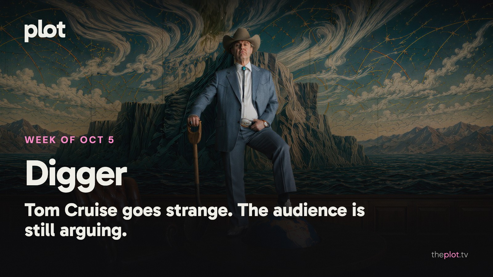

Tom Cruise has traded the reliable rescue mission for something much stranger in *Digger*, and the reactions are part of the attraction. Florence Pugh's *East of Eden* offers a different sort of chaos on Netflix. Ahead, *Other Mommy* and *The Social Reckoning* join theaters, while Ben Affleck brings a kidnapping thriller home. For the weekend: a sea creature, a comedy lifer, or a family gathering you will be grateful you weren't invited to.

Image: Digger (2026), promotional backdrop. Source: [TMDB](https://www.themoviedb.org/movie/1248832). Text overlay by Plot.

## In theaters

*Digger* is a big swing with a small start: [an estimated $8 million domestically over October 2-4](https://www.thewrap.com/creative-content/movies/verity-digger-box-office-bomb/). Cruise plays an oil tycoon facing a catastrophe he helped create. The familiar star has brought a much less familiar movie, and ticket buyers haven't rushed to meet it.

*Verity* opened with [about $32 million domestically over October 2-4](https://www.boxofficemojo.com/weekend/2026W40/?sort=rank&sortDir=asc). The Colleen Hoover adaptation has found ticket buyers. If your book club has been waiting to compare the page with Anne Hathaway's version of its secrets, the meeting can now be held in a theater.

*Forgotten Island* remains the family option. [DreamWorks' adventure asks what two friends would sacrifice to keep their shared memories](https://prod.dreamworks.com/movies/forgotten-island). A useful alternative if the other choices involve too much adult scheming.

## What everyone's talking about

*Digger* makes Tom Cruise's familiar confidence look dangerous. Usually, you trust him to get everyone home. Here, that certainty belongs to a man who has helped put everyone at risk. [Time Out enjoys the performance's swagger and unexpected vulnerability](https://www.timeout.com/movies/digger-review-2026); [Sight and Sound finds Cruise compelling even when the satire strains for laughs](https://www.bfi.org.uk/sight-and-sound/reviews/digger-unwieldy-compulsively-watchable-satire). The [opening audience discussion](https://www.reddit.com/r/movies/comments/1wvhx09/official_discussion_digger_spoilers/) turns on whether all that noise and excess is exhilarating or unbearable. The interesting gamble is watching a star use the very qualities that normally reassure you to make you uneasy. [Find Digger on Plot](https://theplot.tv/movie/digger-1248832).

*East of Eden* has a more intimate provocation: how much do you want to understand a villain? [The New Yorker finds Florence Pugh's Cathy irresistible and sees Zoe Kazan giving her a more sympathetic explanation than Steinbeck did](https://www.newyorker.com/magazine/2026/10/12/east-of-eden-tv-review-netflix). That changes the family saga's center of gravity. You can be appalled by what someone does and still want the story to follow her out of the room. For readers coming from the novel, that is the adaptation choice to watch. For everyone else, Pugh gives you a dangerous reason to keep going.

## Now on TV and Streaming

Image: East of Eden (2026), promotional backdrop. Source: [TMDB](https://www.themoviedb.org/tv/258165).

*East of Eden* arrived on Netflix October 1. [Zoe Kazan's adaptation follows Cathy Ames and the Trask family across generations](https://www.netflix.com/tudum/articles/what-to-watch-on-netflix-september-25-2026). Pick it for the long immersion: troubled brothers, inherited resentments, and Florence Pugh entering a family that already has plenty wrong with it.

Image: Doing Life (2026), promotional backdrop. Source: [TMDB](https://www.themoviedb.org/movie/1458857).

*Doing Life* is [on Netflix from October 2](https://media.netflix.com/en/only-on-netflix/82023496). A single mother and an incarcerated man form a connection through letters. For a night when you want the emotional stakes close to the characters rather than measured in the fate of the world.

Image: Neagley (2026), promotional backdrop. Source: [TMDB](https://www.themoviedb.org/tv/273207).

*Neagley* has expanded the *Reacher* world on Prime Video. [Maria Sten's investigator is pursuing a friend's suspicious death](https://www.aboutamazon.com/news/entertainment/prime-video-september-films-shows-sports-2026). If you like the franchise's appetite for getting things done and want Frances at the center of it, her own case is underway.

Less scrolling. Better watching. Your weekly guide to what's on, what's coming, and what's actually worth your time.

## Coming up

https://www.youtube.com/watch?v=bEpTgowZ1dI

*Other Mommy* opens Friday, October 9. A child faces a threatening presence in her own home. [Universal's Jessica Chastain horror is built around the terror of that intrusion](https://www.universalpictures.com/movies/other-mommy/synopsis/). For anyone who finds a familiar room going wrong scarier than a remote cabin.

https://www.youtube.com/watch?v=gM4LkaXwGuY

*The Social Reckoning* opens Friday, October 9. [Aaron Sorkin follows Facebook whistleblower Frances Haugen and reporter Jeff Horwitz](https://dev.sonypictures.com/movies/thesocialreckoning). The companion to *The Social Network* turns from building the company to exposing what it knows. A different kind of October anxiety.

https://www.youtube.com/watch?v=mlBfQJ8oxB0

*Animals* arrives on Netflix Friday, October 9. Ben Affleck directs and plays an LA mayoral candidate whose son is kidnapped. [Kerry Washington plays his wife as the demand for a ransom threatens their public and private lives](https://www.netflix.com/tudum/articles/animals-ben-affleck-trailer?inapp=true%2F). The pitch is a political image cracking under very personal pressure.

## The charts

Your trending top ten for October 5, 2026.

1. [*Resident Evil*](https://theplot.tv/movie/resident-evil-1423191), film. Holding the top spot
2. [*UNABOMBER*](https://theplot.tv/movie/unabomber-1492640), film. New on the chart this week
3. [*Lanterns*](https://theplot.tv/tv/lanterns-95350), TV. Up 4 this week
4. [*Heart of the Beast*](https://theplot.tv/movie/heart-of-the-beast-1263337), film. New on the chart this week
5. [*The Love Hypothesis*](https://theplot.tv/movie/the-love-hypothesis-1032863), film. New on the chart this week
6. [*Monster: The Lizzie Borden Story*](https://theplot.tv/tv/monster-the-lizzie-borden-story-299939), TV. Down 1 this week
7. [*MobLand*](https://theplot.tv/tv/mobland-247718), TV. Up 1 this week
8. [*Primetime*](https://theplot.tv/movie/primetime-1375441), film. New on the chart this week
9. [*The End of Oak Street*](https://theplot.tv/movie/the-end-of-oak-street-1101383), film. Down 7 this week
10. [*Obsession*](https://theplot.tv/movie/obsession-1339713), film. Up 2 this week

Want more? [See the full top 20 chart on Plot](https://theplot.tv/whats-on/chart).

Chart snapshot: 2026-10-01. Movement compared with 2026-09-24.

## Weekend watch

Image: Below (2026), promotional backdrop. Source: [TMDB](https://www.themoviedb.org/tv/285322).

*Below* reaches Netflix Thursday, October 8. A fisherman tries to protect his family and community from a sea creature. [The release preview sets the coastal stakes](https://www.netflix.com/tudum/articles/what-to-watch-on-netflix-october-2-2026?inapp=true). The choice for anyone who believes an ominous body of water is a perfectly good start to an evening. [Save Below for a creature-feature night](https://app.theplot.tv/save?media_type=tv&tmdb_id=285322&src=newsletter).

Image: Who Is Martin Mull? (2026), promotional backdrop. Source: [TMDB](https://www.themoviedb.org/movie/1756138).

*Who Is Martin Mull?* arrives on Netflix Wednesday, October 7. [The documentary looks past the familiar television roles to his work as a musician, comedian, and painter](https://www.netflix.com/tudum/articles/new-comedy-documentaries-2026). If you know the face better than the person, this is a chance to correct that without committing to another season of anything. [Keep Martin Mull for a documentary night](https://app.theplot.tv/save?media_type=movie&tmdb_id=1756138&src=newsletter).

Image: Evil Dead Burn (2026), promotional backdrop. Source: [TMDB](https://www.themoviedb.org/movie/1212763).

*Evil Dead Burn* has [just reached HBO Max](https://press.wbd.com/us/media-release/evil-dead-burn-begins-streaming-exclusively-hbo-max-october-2). A grieving woman goes to stay with her in-laws; the family reunion soon has a demonic problem. Your pick if October means horror with the volume up. [Save Evil Dead Burn for the horror vote](https://app.theplot.tv/save?media_type=movie&tmdb_id=1212763&src=newsletter).

Save these to your Plot watchlist before Friday. You deserve a weekend plan more ambitious than opening three apps and forgetting why you opened the first one.

Be that friend. Give the group chat its weekend watchlist.

Chart and title artwork: TMDB. This newsletter uses the TMDB API but is not endorsed or certified by TMDB.
