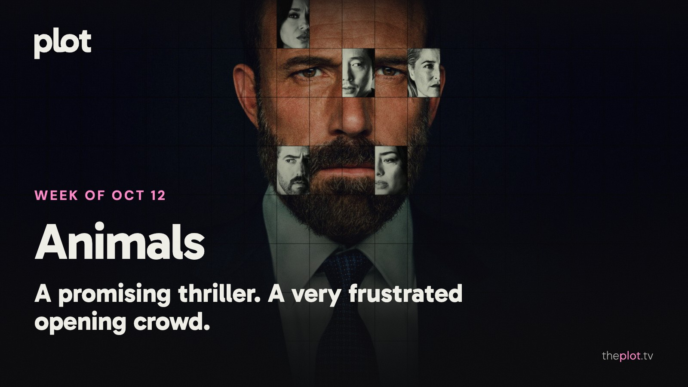

Ben Affleck is explaining the choices behind *Animals*, while *Carrie* has horror fans debating what a new adaptation owes the original. In theaters, *Other Mommy* has drawn a crowd without much affection. This week also brings a Mike Tyson documentary, Trina Vega back at school, and another season of *The Diplomat*. By Friday, you can choose a hostage crisis, a wounded outlaw, or a romance. Nobody said your watchlist had to have a consistent personality.

Image: Animals (2026), promotional backdrop. Source: [TMDB](https://www.themoviedb.org/movie/1236045). Text overlay by Plot.

## In theaters

*Other Mommy* drew a crowd without winning people over: [an estimated $27.5 million domestic opening for October 9-11, alongside a D+ CinemaScore](https://www.thewrap.com/creative-content/movies/other-mommy-27-million-box-office/). The Jessica Chastain horror sold its unsettling premise. Opening-night audiences were much less happy with the full movie.

*The Social Reckoning* turns Aaron Sorkin's attention to Facebook's whistleblower story. [Frances Haugen and reporter Jeff Horwitz are at the center](https://dev.sonypictures.com/movies/thesocialreckoning). The draw is familiar Sorkin territory: people trying to force a powerful institution to answer a question.

*Digger* is still there for anyone who wants to see Tom Cruise outside his reliable blockbuster mode. [Its second domestic weekend brought in about $3.2 million](https://www.boxofficemojo.com/release/rl790986753/weekend/?sort=grossToDate). The spectacle is unusual; the audience is proving harder to find.

## What everyone's talking about

*Animals* comes with an unusually revealing production story. [Ben Affleck tells TheWrap he substantially reworked the script and used AI in post-production for tasks such as adjusting lighting and removing visual effects elements](https://www.thewrap.com/creative-content/movies/ben-affleck-interview-animals-netflix/). He describes a film built to keep you reassessing its characters' morality. That ambition is worth setting beside [the same publication's review, which finds an overly familiar kidnapping thriller with little suspense](https://www.thewrap.com/creative-content/reviews/animals-review-ben-affleck-kerry-washington-gillian-anderson-netflix/). The tools are a talking point, but they don't explain away the more ordinary question: does the story make you care what happens next?

*Carrie* has arrived on Prime Video with another answer to why anyone would revisit a familiar story. The extra time lets Mike Flanagan linger on the teenagers and adults around Carrie, an expansion [TV Insider welcomes](https://www.tvinsider.com/1293931/). Bringing that cruelty into the social-media age makes the bullying harder to leave at the school gates. [GamesRadar+ likes the modern approach but finds the conclusion too busy preparing for more story](https://www.gamesradar.com/entertainment/horror-shows/carrie-mike-flanagan-tv-show-review/). A [Flanagan fan discussion](https://www.reddit.com/r/MikeFlanagan/comments/1x1mc1j/am_i_the_only_one_who_thoroughly_enjoyed_carrie/) has viewers praising the performances while arguing over the changes. Worth discussing after you've finished. Please spare the group chat the ending until then.

## Now on TV and Streaming

Image: Animals (2026), promotional backdrop. Source: [TMDB](https://image.tmdb.org/t/p/original/tzoarEu7TsG959upiELyYPm5kO9.jpg).

*Animals* arrived on Netflix October 9. [Ben Affleck and Kerry Washington play a couple whose son's kidnapping threatens an already carefully managed life](https://www.netflix.com/tudum/articles/animals-ben-affleck-trailer?inapp=true%2F). If the premise still has you curious, it is a self-contained movie-night commitment. Keep the early reservations above in mind.

Image: Below (2026), promotional backdrop. Source: [TMDB](https://www.themoviedb.org/tv/285322).

*Below* is [on Netflix from October 8](https://www.netflix.com/tudum/articles/what-to-watch-on-netflix-october-2-2026?inapp=true). A fisherman is trying to save his community from a sea creature, with his family's safety tangled up in its future. For the viewer who wants a monster story with a whole town to worry about.

Image: Haunted Hotel (2025), promotional backdrop. Source: [TMDB](https://www.themoviedb.org/tv/255752).

*Haunted Hotel* returned to Netflix October 9 with season two. [Katherine and her family are still trying to make a home where paranormal problems keep checking in](https://www.netflix.com/tudum/articles/what-to-watch-on-netflix-october-9-2026). The comedy option when you want the Halloween mood without putting yourself through another full-scale ordeal.

Less scrolling. Better watching. Your weekly guide to what's on, what's coming, and what's actually worth your time.

## Coming up

https://www.youtube.com/watch?v=o1S5LsYhfEg

*TYSON* arrives on Netflix Tuesday, October 13. [The four-part documentary covers Mike Tyson's extraordinary career and the violence and controversies around it](https://www.netflix.com/tudum/articles/mike-tyson-documentary-series-release-date). A choice for viewers who want more than the famous fights and familiar headlines.

https://www.youtube.com/watch?v=IXQP43JjY4Q

*Hollywood Arts* arrives on Netflix Thursday, October 15. Trina Vega returns to the *Victorious* school as a substitute teacher while her own ambitions are still very much alive. [Daniella Monet leads the new comedy](https://www.netflix.com/tudum/articles/hollywood-arts-season-1-filming). For anyone ready to enjoy the alarming passage of time in sitcom form.

https://www.youtube.com/watch?v=for_t1ySDvk

*The Diplomat* returns Thursday, October 15, with [all eight episodes of season four on Netflix](https://www.netflix.com/tudum/articles/the-diplomat-season-4-release-date-photos-news). Keri Russell's Kate Wyler has international crises and two marriages' worth of trouble to untangle. Clear an evening if political negotiation and domestic exasperation are your preferred double feature.

## The charts

Your trending top ten for October 12, 2026.

1. [*LINK CLICK*](https://theplot.tv/tv/link-click-123542), TV. New on the chart this week
2. [*VisionQuest*](https://theplot.tv/tv/visionquest-213375), TV. New on the chart this week
3. [*Animals*](https://theplot.tv/movie/animals-1236045), film. New on the chart this week
4. [*Carrie*](https://theplot.tv/tv/carrie-288673), TV. New on the chart this week
5. [*Matchbox the Movie*](https://theplot.tv/movie/matchbox-the-movie-1148365), film. New on the chart this week
6. [*Spider-Man: Brand New Day*](https://theplot.tv/movie/spider-man-brand-new-day-969681), film. Up 8 this week
7. [*Street Fighter*](https://theplot.tv/movie/street-fighter-1153576), film. New on the chart this week
8. [*Hope*](https://theplot.tv/movie/hope-1058424), film. New on the chart this week
9. [*Crystal Lake*](https://theplot.tv/tv/crystal-lake-213562), TV. New on the chart this week
10. [*Practical Magic 2*](https://theplot.tv/movie/practical-magic-2-1302904), film. New on the chart this week

Want more? [See the full top 20 chart on Plot](https://theplot.tv/whats-on/chart).

Chart snapshot: 2026-10-11. Movement compared with 2026-10-08.

## Weekend watch

Image: Sacrifice (2026), promotional backdrop. Source: [TMDB](https://www.themoviedb.org/movie/1284186).

*Sacrifice* arrives on Netflix Friday, October 16. Chris Evans plays a movie star trying to revive his career when a cult takes hostages at a charity gala. [Anya Taylor-Joy is among the cast](https://www.netflix.com/tudum/articles/sacrifice-movie-release-date-plot-photos). The choice for a movie night with very little polite behavior. [Save Sacrifice for Friday](https://app.theplot.tv/save?media_type=movie&tmdb_id=1284186&src=newsletter).

Image: The Death of Robin Hood (2026), promotional backdrop. Source: [TMDB](https://www.themoviedb.org/movie/1284465).

*The Death of Robin Hood* reaches HBO Max Friday, October 16. Hugh Jackman plays an injured outlaw reckoning with the violence behind his legend. [The October streaming schedule confirms its arrival](https://press.wbd.com/us/media-release/hbo-max/whats-new-hbo-max-october-1). Try this if you want the familiar hero with the triumph stripped away and room for regret. [Keep The Death of Robin Hood for a darker night](https://app.theplot.tv/save?media_type=movie&tmdb_id=1284465&src=newsletter).

Image: Love of Your Life (2026), promotional backdrop. Source: [TMDB](https://www.themoviedb.org/movie/1381078).

*Love of Your Life* arrives on Prime Video Wednesday, October 14. [Rachel Morrison directs Margaret Qualley and Gabriel Basso in a romance set in motion by a chance meeting](https://www.aboutamazon.com/news/entertainment/prime-video-october-films-shows-sports-2026). For the night when the horror queue can wait and you would like to feel something else. [Save Love of Your Life for a change of mood](https://app.theplot.tv/save?media_type=movie&tmdb_id=1381078&src=newsletter).

Give Friday-you a head start: save these to your Plot watchlist now. Finding the good blanket is enough of a task for the end of the week.

Be that friend. Give the group chat its weekend watchlist.

Chart and title artwork: TMDB. This newsletter uses the TMDB API but is not endorsed or certified by TMDB.
