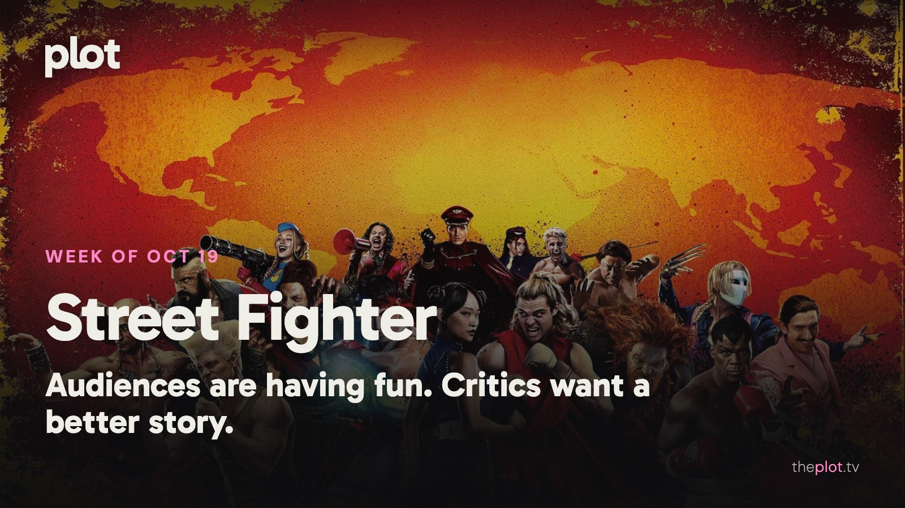

The weekend brought a fight over *Street Fighter* and a survival movie set inside a whale. At home, there's a new school comedy, a Mike Tyson documentary, and another season of *The Diplomat* to lose an evening to. Ahead: *Clayface*, *Wildwood*, and a woman who orders herself a wicker husband. Plus this week's trending top ten and three picks to save now, before your Friday night becomes a feature-length argument about what to put on.

Image: Street Fighter (2026), promotional backdrop. Source: [TMDB](https://www.themoviedb.org/movie/1153576). Text overlay by Plot.

## In theaters

*Street Fighter* brought in [$4 million from Thursday previews](https://www.the-numbers.com/movie/Street-Fighter-%282026%29) on October 15. The [early reviews](https://editorial.rottentomatoes.com/article/street-fighter-2026-first-reviews/) find more to enjoy in the familiar fighters than the script. Ticket buyers have been warmer, which is where things get interesting below.

*Whalefall* puts a diver inside a whale and leaves reviewers arguing about how long they want to stay there. [The Guardian](https://www.theguardian.com/film/2026/oct/15/whalefall-review-movie) finds it overextended; [Esquire](https://www.esquire.com/entertainment/movies/a74132264/whalefall-movie-review/) counts it among the year's scariest films. Your tolerance for tight spaces may decide this one.

*Other Mommy*, the Jessica Chastain horror, drew a crowd without winning people over. [AP's opening-weekend report](https://apnews.com/article/2ea3e0be66e1761851209e45e34ca32c) describes poor reviews from critics and audiences, including a D+ CinemaScore from opening-night moviegoers.

## What everyone's talking about

*Street Fighter* is getting more love from ticket buyers than from reviewers. [Destructoid recorded a 45 percent critic score and an 82 percent audience score on October 16](https://www.destructoid.com/new-street-fighter-movie-has-critics-and-fans-split-but-honestly-whos-surprised/). The appeal is easy to locate: familiar fighters, signature moves, and the noisy pleasure of an arcade brought to life. Recognizing a favorite fighter is one pleasure; getting a story worth following is another. Even the [opening-night Reddit discussion](https://www.reddit.com/r/movies/comments/1x748zl/official_discussion_street_fighter_spoilers/) gets caught on the editing and time jumps. Fans are having fun; the script is still taking a beating.

*The Diplomat* is the happier conversation at home. The [early season-four reviews collected by Rotten Tomatoes](https://www.rottentomatoes.com/tv/the_diplomat/s04) are strongly positive, and [the Guardian](https://www.theguardian.com/tv-and-radio/2026/oct/15/the-diplomat-review-nothing-else-on-tv-is-as-entertaining-as-this-exquisitely-stressful-show) finds its escalating stress enormously entertaining. The appeal is watching very capable people make a mess of both diplomacy and their marriages. If you fell behind, this is a reason to catch up. If you've already finished, please give the group chat a minute before discussing the ending.

## Now on TV and Streaming

Image: Hollywood Arts (2026), promotional backdrop. Source: [TMDB](https://www.themoviedb.org/tv/286183).

*Hollywood Arts* is for the part of you that still remembers the *Victorious* theme song. [The new Netflix comedy arrived October 15](https://www.netflix.com/tudum/articles/hollywood-arts-season-1-filming), with Daniella Monet back as Trina Vega, still chasing her own acting break while teaching a new class of performing-arts kids. School chaos, big ambitions, and the alarming realization that Trina is now the responsible adult.

Image: TYSON (2026), promotional backdrop. Source: [TMDB](https://www.themoviedb.org/tv/335536).

*TYSON* goes beyond the highlight reel. [Netflix's four-part documentary](https://www.netflix.com/tudum/articles/mike-tyson-documentary-series-release-date) follows the champion's rise alongside the violence, prison, money trouble, and addiction that complicated his life. Tyson and people close to him take part in the interviews. Put this on when you want the longer, uncomfortable story behind a figure you've mostly encountered in headlines.

Image: The Diplomat (2023), promotional backdrop. Source: [TMDB](https://www.themoviedb.org/tv/203857).

*The Diplomat* is back for anyone who likes their political crises tangled up with marital ones. Keri Russell's Kate Wyler is trying to hold international relations together while two marriages threaten to pull everything apart. [All eight episodes of season four are on Netflix](https://www.netflix.com/tudum/articles/the-diplomat-season-4-release-date-photos-news). Your pick if you want another episode before you've finished discussing the last one.

## Coming up

https://www.youtube.com/watch?v=mo7-mJ6wKho

*Clayface* is the one for horror fans curious about what DC does outside the usual superhero shape. An actor's career is destroyed by a disfiguring attack; the treatment that restores his face starts unraveling his mind. James Watkins directs, with a screenplay co-written by Mike Flanagan. [It opens Friday, October 23](https://www.clayfacemovie.com/synopsis/). A comeback story with very bad side effects.

https://www.youtube.com/watch?v=dtr5JL1zkiM

*Wildwood* is the next big-screen outing from LAIKA, the studio behind *Coraline*. A girl enters a hidden forest to rescue her baby brother and finds a whole dangerous world in the way. The draw is the handmade stop-motion world as much as the rescue. [It opens nationwide Friday, October 23](https://www.movieinsider.com/m9508/wildwood).

https://www.youtube.com/watch?v=HP0BWBWn14I

*Wicker* is for anyone whose idea of romance could use a little more village outrage. Olivia Colman plays a fisherwoman tired of being mocked by her neighbors, so she commissions herself a husband made from wicker. Alexander Skarsgård is the husband. A very strange meet-cute, with jealousy to follow. [It opens Friday, October 23](https://www.blackbearpictures.com/film-and-tv/wicker).

## The charts

Your trending top ten for October 19, 2026.

1. [*Crystal Lake*](https://theplot.tv/tv/crystal-lake-213562), TV. New on the chart this week
2. [*LINK CLICK*](https://theplot.tv/tv/link-click-123542), TV. Down 1 this week
3. [*VisionQuest*](https://theplot.tv/tv/visionquest-213375), TV. New on the chart this week
4. [*Hope*](https://theplot.tv/movie/hope-1058424), film. New on the chart this week
5. [*Spider-Man: Brand New Day*](https://theplot.tv/movie/spider-man-brand-new-day-969681), film. Down 3 this week
6. [*Animals*](https://theplot.tv/movie/animals-1236045), film. Down 2 this week
7. [*Carrie*](https://theplot.tv/tv/carrie-288673), TV. Down 4 this week
8. [*Street Fighter*](https://theplot.tv/movie/street-fighter-1153576), film. New on the chart this week
9. [*Tenzing*](https://theplot.tv/movie/tenzing-1288069), film. New on the chart this week
10. [*Matchbox the Movie*](https://theplot.tv/movie/matchbox-the-movie-1148365), film. Down 5 this week

Want more? [See the full top 20 chart on Plot](https://theplot.tv/whats-on/chart).

## Weekend watch

Image: Sacrifice (2026), promotional backdrop. Source: [TMDB](https://www.themoviedb.org/movie/1284186).

*Sacrifice* is the new movie for a night when polite conversation has worn thin. [It arrived on Netflix on October 16](https://www.netflix.com/tudum/articles/sacrifice-movie-release-date-plot-photos), and follows a movie star whose attempt at a career comeback is interrupted when a cult takes him hostage at a charity gala. Chris Evans plays the movie star. [Save Sacrifice for Friday night](https://app.theplot.tv/save?media_type=movie&tmdb_id=1284186&src=newsletter).

Image: Nobody Wants This (2024), promotional backdrop. Source: [TMDB](https://www.themoviedb.org/tv/250923).

*Nobody Wants This* offers the less volcanic option. [Season three brings all ten episodes to Netflix on October 22](https://www.netflix.com/tudum/articles/nobody-wants-this-season-3-news-cast-release-date). Joanne and Noah are moving in together. The question has moved from whether they get together to how they live together, which makes this the pick for a sofa weekend. [Keep Nobody Wants This for the weekend](https://app.theplot.tv/save?media_type=tv&tmdb_id=250923&src=newsletter).

Image: Carrie (1976), promotional backdrop. Source: [TMDB](https://www.themoviedb.org/movie/7340).

Make it a *Carrie* double feature. Start with the 1976 film, then try the [new series on Prime Video](https://www.aboutamazon.com/news/entertainment/carrie-stephen-king-mike-flanagan-prime-video). See what still gets under your skin, and what a series has room to change. [Save the original Carrie](https://app.theplot.tv/save?media_type=movie&tmdb_id=7340&src=newsletter).

Give Friday-you a small gift: save these picks to your Plot watchlist now. Snacks are the only weekend problem you need. Leave deciding what to watch to Plot.

Chart and title artwork: TMDB. This product uses the TMDB API but is not endorsed or certified by TMDB.
