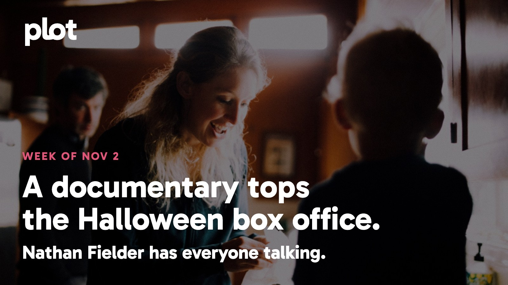

Halloween is over, but nobody has told the box office. *Clayface* is still melting down, and Nathan Fielder has turned a documentary about Elizabeth Holmes into the weekend's biggest draw. At home, a new Ali drama is getting the kind of reviews that make room in your schedule. Ahead: *Black Doves* returns, two marriages collide in *Possible Love*, and a trip behind the scenes of *Marie Antoinette* offers a considerably prettier kind of tension.

Image: You Can See Everything, promotional backdrop. Source: [TMDB artwork](https://image.tmdb.org/t/p/original/nhIL3O4W9h5V5JbNQm7yjoDk3So.jpg). Text overlay by Plot.

## In theaters

Image: Clayface, promotional artwork. Source: [TMDB](https://www.themoviedb.org/movie/1400940).

*You Can See Everything* took the top spot with [about $11.4 million over October 30-November 1](https://www.boxofficemojo.com/weekend/2026W44/), ahead of *Clayface*. A documentary outdrawing a comic-book horror movie on Halloween weekend is a pretty good reason to ask what everyone has been talking about.

*Clayface* puts a rising actor through a particularly gruesome identity crisis. [Time Out enjoys the film's noir plotting and body horror](https://www.timeout.com/movies/clayface-review-2026). Choose this if your ideal DC movie owes more to *The Fly* than a team-up announcement.

*Wildwood* is Laika's latest stop-motion film, and [RogerEbert.com welcomes the studio's return to fairy-tale adventure](https://www.rogerebert.com/reviews/wildwood-laika-studios-stop-motion-animation-film-review-2026). The alternative for a movie night that wants imagination without quite so much exposed flesh.

## What everyone's talking about

*You Can See Everything* makes access look like a trap. Elizabeth Holmes invited the filmmakers into her home to change the public story about her. The fascination is watching everyone try to control what that invitation means. [The New Yorker finds a compelling contest of manipulation and apparent sincerity](https://www.newyorker.com/magazine/2026/10/19/you-can-see-everything-movie-review). In an [enthusiastic audience thread](https://www.reddit.com/r/billsimmons/comments/1x749tr/you_can_see_everything_2026_is_brilliant_no/), the conversation keeps returning to how the film plays with the documentary form. That thread isn't a verdict from every ticket buyer, but it does explain the urge to discuss this afterward. Go with someone who won't need to rush home.

Image: The Greatest, promotional artwork. Source: [TMDB](https://www.themoviedb.org/tv/258989).

*The Greatest* has a sensible answer to the question hanging over another Muhammad Ali biography: narrow the frame. The new Prime Video series concentrates on the young boxer becoming a champion, rather than trying to fit an entire legend into eight episodes. [TheWrap praises the drama for finding a complicated person beneath the reputation](https://www.thewrap.com/creative-content/reviews/the-greatest-amazon-review-prime-video/), and [RogerEbert.com singles out Jaalen Best's performance and the ensemble](https://www.rogerebert.com/reviews/the-greatest-muhammad-ali-prime-video-tv-review-2026). Both find a reason to revisit a life you may think you already know. You don't need a working knowledge of boxing to recognize the pull of someone learning how much his voice can do.

## Now on TV and Streaming

Image: Collision Course, promotional artwork. Source: [TMDB](https://www.themoviedb.org/movie/1571955).

*Collision Course* is [Netflix's new Spanish thriller](https://about.netflix.com/en/news/collision-course-the-new-film-by-daniel-sanchez-arevalo-premieres-on-netflix-on-30-october), released October 30. A bank getaway crash exposes the people behind the robbery and the lies that arrived before it. Pick this when a plan going wrong is much more appealing than watching someone carefully execute one.

Image: SCTV: The Greatest Show You've Never Heard Of, promotional artwork. Source: [TMDB](https://www.themoviedb.org/movie/1756307).

*SCTV: The Greatest Show You've Never Heard Of* is a [new documentary film on Netflix](https://www.netflix.com/title/82059675). Reunited cast members look back at the scrappy Canadian sketch show that helped shape modern comedy. A good invitation for anyone who loves seeing funny people explain how they found each other.

## Coming up

https://www.youtube.com/watch?v=vbdnFFMhuY0

*The Greatest* arrives Wednesday, November 4 on Prime Video, with all eight episodes available. Jaalen Best plays the young Muhammad Ali in a drama about ambition, family, and finding a public voice. The early reviews above make this the week's strongest invitation to start a new series.

https://www.youtube.com/watch?v=MOU2thjq6Z0

*Black Doves* returns to Netflix Thursday, November 5. In season two, Keira Knightley's spy is even closer to the center of British government, just as her professional safety net disappears. A dangerous job, a complicated friendship, and absolutely no chance of leaving work at work.

https://www.youtube.com/watch?v=JOMS_m5Iqos

*North of North* brings season two to Netflix Thursday, November 5. Siaja is building a life on her own terms in an Arctic community where nobody is quite anonymous. The warmer choice if your week has already supplied enough conspiracies.

## The charts

Your trending top ten for November 2, 2026.

1. [*Verity*](https://theplot.tv/movie/verity-1283515), film. New on the chart this week
2. [*The Dog Stars*](https://theplot.tv/movie/the-dog-stars-1384216), film. New on the chart this week
3. [*Obsession*](https://theplot.tv/movie/obsession-1339713), film. Up 11 this week
4. [*Clayface*](https://theplot.tv/movie/clayface-1400940), film. Down 2 this week
5. [*Lupin*](https://theplot.tv/tv/lupin-96677), TV. Down 2 this week
6. [*Ali G: Who Iz I?*](https://theplot.tv/movie/ali-g-who-iz-i-1727734), film. New on the chart this week
7. [*Dead-End Job*](https://theplot.tv/tv/dead-end-job-289517), TV. New on the chart this week
8. [*Drive - The Pretenders*](https://theplot.tv/movie/drive-the-pretenders-1596275), film. New on the chart this week
9. [*Bleach*](https://theplot.tv/tv/bleach-30984), TV. New on the chart this week
10. [*Spider-Man: Brand New Day*](https://theplot.tv/movie/spider-man-brand-new-day-969681), film. Down 2 this week

Want more? [See the full top 20 chart on Plot](https://theplot.tv/whats-on/chart).

## Weekend watch

Image: Possible Love, promotional artwork. Source: [TMDB](https://www.themoviedb.org/movie/1483525).

*Possible Love* reaches Netflix Friday, November 6. [Lee Chang-dong's first film in eight years follows two married couples brought together by a documentary](https://about.netflix.com/en/news/possible-love-premieres-november-6). Their different circumstances and hidden desires make the encounter less straightforward than either household might like. Save this for a night when a look across a room can be as loaded as a chase. [Save Possible Love for the weekend](https://app.theplot.tv/save?media_type=movie&tmdb_id=1483525&src=newsletter).

Image: Making Marie Antoinette, promotional artwork. Source: [TMDB](https://www.themoviedb.org/movie/1754364).

*Making Marie Antoinette* comes to MUBI Friday, November 6. [Eleanor Coppola's documentary follows her daughter Sofia directing at Versailles](https://movingimage.org/event/making-marie-antoinette/), turning long-unseen footage into a film about the work behind the spectacle. Come for the costumes; stay for the unusual experience of watching a director through her mother's camera. [Save Making Marie Antoinette for the weekend](https://app.theplot.tv/save?media_type=movie&tmdb_id=1754364&src=newsletter).

Give Friday-you a head start: save your picks to your Plot watchlist now. The blanket can be a last-minute decision. The movie doesn't have to be.

Be that friend. Give the group chat its weekend watchlist.

Chart and title artwork: TMDB. This product uses the TMDB API but is not endorsed or certified by TMDB.
